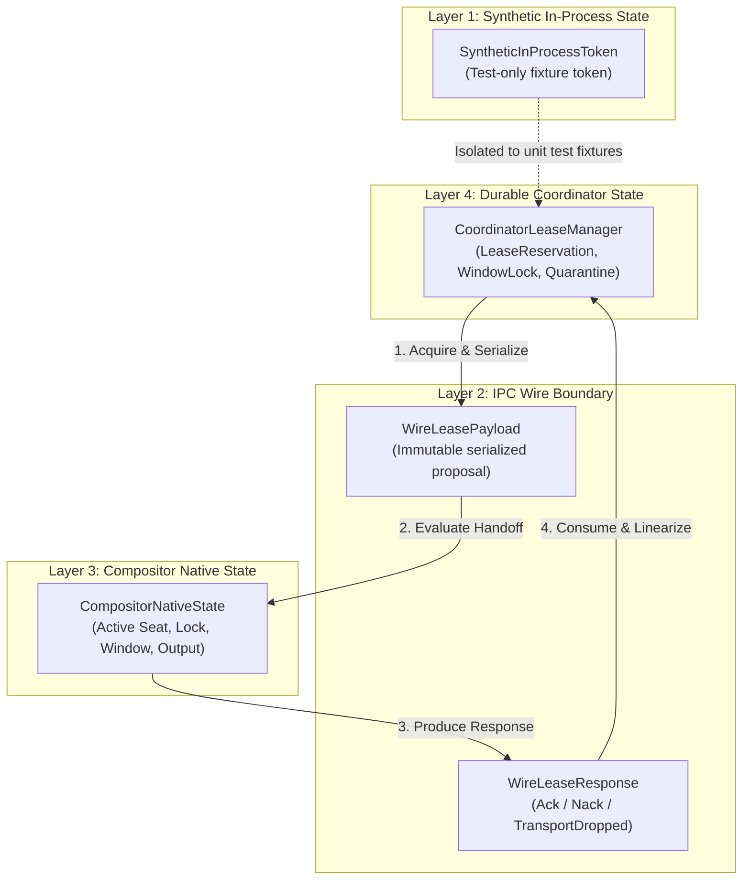

# Phase 3.8 Rust Coordinator Lease and Consistency Integration

## Overview

In the DepthOS multi-process architecture, desktop manipulation proposals traverse a distributed boundary between the Coordinator (managing logical desktop hierarchies, placement policies, and intent), the Observer (monitoring window and workspace state), and the Compositor (owning native Wayland surfaces and spatial arrangement).

Phase 3.8 introduces a formal, test-only coordinator reservation protocol in Rust (`src/action_security/lease.rs`) paired with an end-to-end consistency integration model (`tests/consistency_integration.rs`). This protocol enforces mutual exclusion, unambiguous lifecycle binding, fail-closed handling of lost acknowledgments, and quarantine of uncertain states.

## 1. Coordinator Lease Architecture

### Reservation State and Invariants

The `CoordinatorLeaseManager` maintains reservations over window operations. A lease binds the full contextual horizon of both the coordinator and compositor environments:

```rust
pub struct LeaseReservation {
    pub lease_id: LeaseId,
    pub operation_id: RequestId,
    pub window: WindowKey,
    pub native_uuid: Uuid,
    pub operation: Operation,
    pub acquired_at: Tick,
    pub expires_at: Tick,
    pub coordinator_incarnation: Uuid,
    pub coordinator_epoch: u64,
    pub checkpoint_epoch: Uuid,
    pub checkpoint_sequence: u64,
    pub observer_incarnation: Uuid,
    pub observer_version_seq: u64,
    pub policy_revision: Uuid,
    pub topology_revision: Uuid,
    pub compositor_incarnation: Uuid,
    pub outcome: Option<TerminalOutcome>,
}
```

### The 5 Linearization Points

The lease protocol defines five unambiguous linearization points:

1. **Acquisition (`CoordinatorLeaseManager::acquire`)**:
   - The coordinator atomics verify that no active or quarantined reservation exists for the target window or operation ID.
   - Verifies compositor incarnation matches the active compositor.
   - Verifies tick deadline has not already elapsed.
   - Transitions state to `LeaseState::Active`. Conflicting coordinator operations on the target window are blocked.

2. **Revocation (`CoordinatorLeaseManager::revoke`)**:
   - Explicit cancellation before dispatch or consumption.
   - Transitions state to `LeaseState::Revoked`.
   - Releases the window lock immediately.

3. **Expiration (`CoordinatorLeaseManager::check_expiry`)**:
   - Evaluated monotonically using monotonic discrete `Tick`.
   - When `current_tick >= expires_at`, an active reservation transitions to `LeaseState::Expired`.
   - Releasing the window occurs safely if no uncertain dispatch was initiated.

4. **Consumption / Dispatch (`CoordinatorLeaseManager::consume_synthetic`)**:
   - The coordinator delivers the lease to the native sink.
   - If the sink returns positive confirmation (`Applied`), the lease transitions to `LeaseState::Terminal(TerminalOutcome::Applied)`.
   - If the sink rejects (`RejectWithoutEffect`), it transitions to `LeaseState::Terminal(TerminalOutcome::Rejected)`.
   - The reservation is spent; re-execution or replay is strictly prohibited.

5. **Quarantine / Uncertainty (`CoordinatorLeaseManager::quarantine_window`)**:
   - If communication with the native compositor is interrupted, dropped, or timed out after dispatch, the outcome of the native operation cannot be verified.
   - The reservation transitions to `LeaseState::Quarantined`.
   - The window is locked into a **quarantined state** preventing further mutations until an out-of-band state reconciliation or epoch increment occurs.

### Conflict Prevention and Quarantine on Uncertainty

A foundational rule of distributed systems applies to the lease protocol:
> **Uncertainty Invariant**: A network drop, IPC disconnect, or dispatch timeout is **NEVER** interpreted as proof that dispatch did not occur. If an acknowledgment is lost after dispatch, the coordinator must assume the operation may have completed natively, and must quarantine the conflicting state rather than retrying.

Attempting to retry an uncertain operation could result in double-execution, desktop placement thrashing, or race conditions. Quarantining isolates the window and ensures subsequent proposals for that window are rejected (`LeaseError::WindowQuarantined`).

## 2. Test Verification Matrix

`src/action_security/lease.rs` implements comprehensive unit tests covering all required fault scenarios:

1. **Acquisition**: Verifies complete contextual binding, active window locking, and duplicate prevention.
2. **Revocation**: Verifies explicit early cancellation cleanly releases window locking.
3. **Expiration**: Verifies tick-based deadline expiration and lock release.
4. **Compositor Restart**: Verifies that any change in `compositor_incarnation` immediately invalidates pending leases.
5. **Coordinator Restart**: Verifies that coordinator reboot (fresh incarnation/epoch) invalidates and clears stale reservations.
6. **Lost Acknowledgment**: Simulates `SyntheticSinkAction::LostAckAfterApply`; proves that uncertainty results in `LeaseError::Quarantined` and locks the window against subsequent mutations.
7. **Concurrent Conflicting Proposals**: Verifies that multiple proposals targeting the same window are refused (`LeaseError::WindowLocked`).
8. **Crash Before Consumption**: Verifies crash recovery when the lease was acquired but not yet dispatched to the sink.
9. **Crash After Synthetic Consumption**: Verifies that a crash occurring after consumption does not permit re-dispatch.
10. **Recovery Without Replay**: Verifies that upon restart, replaying an old operation ID or lease ID is refused (`LeaseError::Replay`).

All 10 tests run and pass offline (`cargo test action_security::lease`).

## 3. Consistency Integration (Four Layer Separation)

The consistency integration test (`tests/consistency_integration.rs`) models the end-to-end handoff between the Rust coordinator and the compositor while strictly separating concerns across four architectural layers:



### Layer Definitions

1. **Layer 1: Synthetic In-Process State (`SyntheticInProcessToken`)**:
   - Transient tokens existing solely in test harnesses and unit test fixtures.
   - Tested to ensure synthetic tokens never leak into production capability issuers or the `Authorizer`.
2. **Layer 2: IPC Wire Boundary (`WireLeasePayload`, `WireLeaseResponse`)**:
   - Explicit serialized structures crossing process boundaries.
   - Carries immutable window identity, target desktops, incarnations, and monotonic deadlines.
3. **Layer 3: Compositor Native State (`CompositorNativeState`)**:
   - Represents the live compositor environment: active seat, lock state, current desktop, and prompt visibility.
   - Evaluates handoff requests strictly against current frame state.
4. **Layer 4: Durable Coordinator State (`CoordinatorLeaseManager`)**:
   - Tracks persistent reservations, epochs, and window quarantine sets.

### End-to-End Scenarios Tested

`tests/consistency_integration.rs` verifies four critical properties:
1. `test_layer_distinction_and_positive_handoff`: Validates complete traversal from Layer 4 lease acquisition, Layer 2 serialization, Layer 3 native evaluation, to Layer 4 synthetic consumption.
2. `test_native_lock_transition_forces_refusal`: Validates that a native lock transition occurring during transmission causes Layer 3 refusal (`"screen-locked"`), resulting in Layer 4 clean rejection without mutation.
3. `test_transport_drop_triggers_quarantine_without_retry`: Validates that a transport drop (Layer 2 failure) results in Layer 4 quarantine, and proves the invariant that replays are rejected.
4. `test_synthetic_token_does_not_leak_into_production_capability`: Validates that the production `Authorizer` strictly refuses interaction claims even if synthetic tokens are present.

All 4 integration tests pass (`cargo test --test consistency_integration`).

## 4. Production Boundary and Unsupported Gates

In keeping with DepthOS security principles:
- **No Production Writable D-Bus Methods**: No D-Bus methods exist to request lease acquisition, token minting, or native window relocation from external clients.
- **No Production Capability Issuer**: The production authority remains strictly deny-only.
- **No Unproven Distributed Guarantees**: We do not claim atomic distributed execution across asynchronous D-Bus IPC without an out-of-band consensus protocol. The coordinator lease operates on the principle of pessimistic reservations and fail-closed quarantine.
