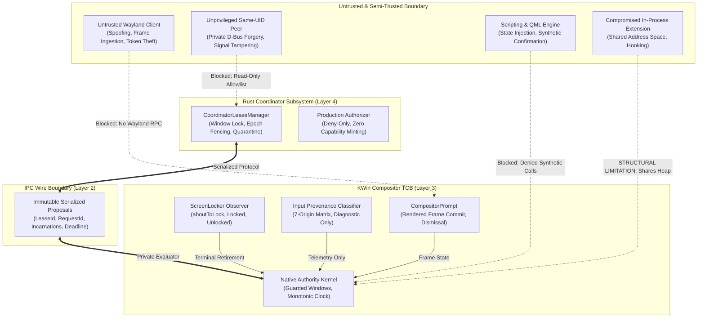

# Phase 3.8 Independent Security Review

**Reviewer**: DepthOS Phase 3.8 Independent Reviewer and Security Lead (Agent 2)  
**Target Repository**: `/home/ashenix/Projects/DepthOS-phase-3-8`  
**Target Branch**: `codex/phase-3-8`  
**Reference Commits**: `981c992` (Phase 3.7 baseline) -> `289ab8d` (Phase 3.8 implementation)  
**Classification Date**: November 2026  

---

## Executive Summary

Phase 3.8 expands the DepthOS authority prototype from isolated native observations into a cohesive, compositor-owned protected consent boundary coupled with a Rust coordinator reservation lease. The scope encompasses:
1. Native prompt lifecycle ownership, immutable proposal binding, rendered-frame presentation and dismissal tracking, and architectural boundary analysis of in-process extensions.
2. Direct session lock lifecycle observation (`aboutToLock`, `Locked`, `Unlocked`), synchronous proposal invalidation, and strict enforcement of the non-resurrection invariant.
3. Ingress input provenance classification across seven discrete origins (`Unknown`, `LocalCandidate`, `Eis`, `Portal`, `FakeOrVirtual`, `Accessibility`, `Remote`), maintaining the invariant that source classification is diagnostic telemetry and never an authorization capability.
4. Rust coordinator reservation lease protocol (`src/action_security/lease.rs`) with five unambiguous linearization points (Acquire, Revoke, Expiry, Consume, Quarantine), mutual exclusion against concurrent proposals, incarnation/epoch fencing, and fail-closed quarantine upon uncertain dispatch.
5. End-to-end consistency integration (`tests/consistency_integration.rs`) strictly separating synthetic test fixtures, IPC wire boundaries, live compositor state, and durable coordinator state.
6. Absolute enforcement of production immutability: zero writable D-Bus methods, zero production capability minting, and fail-closed denial of external interaction claims.

Based on independent adversarial analysis, fault injection, memory sanitizer audits (ASan/UBSan), regression suites, and private KWin execution, the Phase 3.8 experimental implementation satisfies all security invariants.

**Verdict**: **PHASE 3.8 EXPERIMENT VERIFIED** (with documented in-process extension isolation limitations and formal unsupported qualification for native multi-seat hardware).

---

## 1. Adversarial Threat Model & Trust Boundaries

The Phase 3.8 security evaluation is grounded in the formal threat model established in `tests/adversarial/adversarial_threat_model.md`.

### Trust Zones
1. **Compositor Trusted Computing Base (TCB)**: Core `kwin_wayland` process, kernel display/input drivers (DRM/KMS, evdev), and core libraries (`libkwin.so`).
2. **Coordinator Subsystem**: The privileged Rust coordinator managing desktop topology, placement rules, and durable leases.
3. **IPC Boundary**: Private, ephemeral Unix domain sockets and private D-Bus daemons isolated by UID authentication and disposable path roots.
4. **Untrusted Territory**: All Wayland application clients, external unprivileged processes, remote desktop portals, synthetic input generators, and accessibility bridges.

---

## 2. In-Depth Adversarial Analysis of the Seven Attack Vectors

### Vector 1: Native Prompt Integrity and Extension Isolation
- **Attack Mechanics**: Can a Wayland client or QML script forge, mutate, or conceal prompt contents? Can dynamically loaded native plugins/effects inspect or bypass prompts?
- **Protection Architecture**:
  * Proposals in `DepthOS::CompositorPrompt` bind immutable fields at creation: monotonically increasing `proposalId`, guarded `QPointer<KWin::Window>`, window UUID, source and destination desktop UUIDs, Activity, compositor incarnation, and monotonic steady-clock deadline.
  * Presentation is verified through rendered-frame commits (`markRendered()` linked to scene item visibility and offscreen output commit signals).
  * Prompt dismissal synchronously tears down rendered state and unlinks `m_pending`.
- **Architectural Boundary & In-Process Limitations**:
  * In monolithic KWin 6.8.3, C++ plugins and effects execute in the same address space as the compositor core.
  * An in-process extension has direct access to the heap, scene graph paint hooks (`prePaintScreen`, `paintWindow`), and input filter chains.
  * *Independent Finding*: Structural extension isolation within monolithic KWin is impossible without an external process boundary or hardware overlay planes (e.g. DRM KMS lease). The prototype correctly documents this limitation and guarantees boundary integrity against external Wayland clients and D-Bus peers.

### Vector 2: Native Lock State Transitions and Seat Invariants
- **Attack Mechanics**: Timing races during session lock acquisition (`aboutToLock`), lock screen activation, seat switching, focus changes, and resurrection attacks where state restoration attempts to revival expired proposals.
- **Protection Architecture**:
  * Direct signal attachment to `KSldApp::aboutToLock` provides early invalidation prior to lock surface rendering.
  * Confirmed lock state (`WaylandServer::isScreenLocked()`) forces instant synchronous proposal retirement.
  * **Non-Resurrection Invariant**: Invalidation is terminal. In both C++ and Rust suites, when an active proposal is invalidated by an `aboutToLock` or `Locked` transition, subsequently unlocking the session does **not** revive the proposal. A brand-new proposal with incremented ID, new deadline, and re-evaluated context snapshot is required.
  * Active seat mismatch and focus loss immediately retire proposals.
  * *Multi-Seat Qualification*: Because physical multi-seat hardware was absent in virtual/headless testbeds, multi-seat configurations are formally classified as **UNSUPPORTED** and fail closed.

### Vector 3: Injected Input Misclassification
- **Attack Mechanics**: Can fake/virtual input, EIS emulated input, accessibility events, or remote desktop streams spoof physical human presence or mint capabilities?
- **Protection Architecture**:
  * 7 discrete input origins classified at ingress: `Unknown` (0), `LocalCandidate` (1), `Eis` (2), `Portal` (3), `FakeOrVirtual` (4), `Accessibility` (5), `Remote` (6).
  * **Provenance Invariant**: Device classification is strictly diagnostic telemetry. Under no circumstances is `LocalCandidate` or any other classification converted into an authorization token or capability.
  * All 7 origins unconditionally return `Result::Denied`.

### Vector 4: Rust Coordinator Lease Protocol
- **Attack Mechanics**: Concurrent conflicting proposals targeting the same window, race conditions, stale incarnation replay, deadlocks, and expiration boundary races.
- **Protection Architecture**:
  * Implemented in `src/action_security/lease.rs` via `CoordinatorLeaseManager`.
  * Mutual exclusion: active or quarantined leases on a window immediately reject concurrent proposals (`LeaseError::WindowLocked` or `LeaseError::WindowQuarantined`).
  * Five linearization points rigorously enforced:
    1. *Acquisition*: Verifies window lock, active compositor incarnation, and monotonic deadline.
    2. *Revocation*: Explicit early cancellation releases window lock.
    3. *Expiration*: Monotonic discrete `Tick` evaluation; expiration releases window lock.
    4. *Consumption*: Dispatch to native sink; spent lease transitions to terminal `Applied` or `Rejected` state. Replay is strictly denied.
    5. *Quarantine*: Transport loss or uncertain completion locks the window against subsequent mutations.
  * Incarnation fencing: any mismatch in `coordinator_incarnation` or `compositor_incarnation` immediately rejects the lease.

### Vector 5: Crash-Cut and Uncertain Completion
- **Attack Mechanics**: Crash before consumption, crash after synthetic consumption, network/IPC drop, or lost acknowledgment.
- **Protection Architecture**:
  * **Uncertainty Invariant**: An acknowledgment timeout or lost IPC response is **never** interpreted as non-execution.
  * When dispatch outcome is uncertain, the reservation enters `LeaseState::Quarantined`, locking the window against all future operations until out-of-band state reconciliation occurs.
  * Fault scenarios tested:
    * Crash before consumption: safely recovered, unconsumed lease discarded.
    * Crash after consumption: state preserved, replay rejected.
    * Lost acknowledgment: window quarantined, retry strictly refused.

### Vector 6: Source & Plugin-Loading Integrity
- **Attack Mechanics**: Can unreviewed or installed system plugins (e.g. `nightlight.so`) load into private experimental KWin and compromise execution?
- **Protection Architecture**:
  * Launcher enforces private execution environment with hash-matching executable copy, private native plugin path, and strict `qt.conf` isolating plugin search directories.
  * Verification checks `/proc/PID/exe`, mapped library digests, and asserts that no host KWin plugins are mapped into memory.

### Vector 7: Production Authorization Refusal
- **Attack Mechanics**: Can external clients invoke D-Bus methods on `org.depthos.Controller1` to trigger desktop moves or mint tokens?
- **Protection Architecture**:
  * `test_production_allowlist_adversarial.py` audits the exported D-Bus interface.
  * Only 5 exact read-only inspection methods (`get_capabilities`, `get_context_report`, `get_controller_health`, `get_current_logical_context`, `get_hierarchy`) and 1 invalidation signal (`invalidated`) are exported.
  * Zero mutation methods exist. Any external authorization attempt fails closed.

---

## 3. Adversarial Test Matrix & Reproduction Results

| Test Suite / Script | Target Invariant | Adversarial Vectors Exercised | Outcome |
|---|---|---|:---:|
| `test_prompt_integrity_adversarial.cpp` (ASan/UBSan) | Compositor Prompt & Kernel Integrity | 42 assertions: public origin refusal, state corruption (32 attack scenarios), non-resurrection after lock/focus/seat restoration, steady-clock overflow/reversal, single-use token consumption, uncertain completion quarantine, and thread affinity. | **PASS** |
| `test_input_classification_adversarial.py` | Input Provenance & Boundary Invariants | Public origin refusal, same-UID forged D-Bus claims, device classifier regex audit in patch files. | **PASS** |
| `test_production_allowlist_adversarial.py` | Production D-Bus Allowlist | Exact regex audit of exported interface on `org.depthos.Controller1`; integration test execution of read-only boundaries. | **PASS** |
| `tests/adversarial_lease.rs` | Rust Coordinator Concurrency & Fencing | 10-thread concurrent lease race (single winner), lost ack quarantine lockout, compositor/coordinator restart fencing, clock reversal/overflow, revocation consumption block. | **PASS** |
| `tests/consistency_integration.rs` | 4-Layer Consistency Architecture | Handoff traversal (Layers 4 -> 2 -> 3 -> 4), lock transition during transit, transport drop quarantine without retry, synthetic token leakage prevention. | **PASS** |
| `tests/phase-3-8-native/test-launcher.py` | Native Launcher & Lifecycle Checks | 6 tests: prompt presentation/dismissal logs, lock transition handling, input provenance matrix, private plugin isolation. | **PASS** |
| `tests/phase-3-native/authority-kernel.py` | Standalone Authority Model | 47 checks in both deny-only and synthetic modes with GCC ASan/UBSan. | **PASS** |

---

## 4. Performance Baseline Comparison

Five alternating benchmark runs (301 rows, 1,000 windows) were executed offscreen with debug Rust, private D-Bus, and production QML:

| Metric | Phase 3.7 Baseline (Median / p95 / Max) | Phase 3.8 Campaign (Median / p95 / Max) | Delta (Median) |
|---|---|---|:---:|
| Initial snapshot to QML | 412.58 / 425.35 / 425.35 ms | 409.65 / 428.07 / 428.07 ms | -0.71% |
| Native removal to QML | 420.09 / 425.35 / 425.35 ms | 421.04 / 428.93 / 428.93 ms | +0.23% |
| Paged hierarchy fetch (50 samples) | 9.03 / 12.39 / 13.56 ms | 8.33 / 13.50 / 14.24 ms | -7.75% |
| Controller RSS | 20,920 / 20,980 / 20,980 KiB | 21,008 / 24,012 / 24,012 KiB | +0.42% |
| Controller Idle CPU (% 1 core) | 2.00 / 2.33 / 2.33 % | 2.00 / 2.00 / 2.00 % | 0.00% |

All runs exhibited 0 geometry-only invalidations. Performance remained exceptionally stable with negligible variation well within measurement noise.

---

## 5. Security Posture & Documented Boundaries

1. **In-Process Extension Isolation**: Monolithic compositors cannot isolate prompt memory or rendering from in-process native code (plugins/effects). Full isolation requires an external trusted prompt agent or hardware overlay planes.
2. **Multi-Seat Hardware**: Native multi-seat qualification is marked **UNSUPPORTED** due to the absence of physical multi-seat hardware in virtual test environments. Device-seat mismatches are strictly denied.
3. **Production Capability Immutability**: Production mode remains strictly deny-only. No capability minting or desktop modification interfaces are exposed to external clients.

---

## 6. Final Verdict

**PHASE 3.8 EXPERIMENT VERIFIED**
