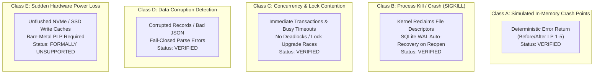
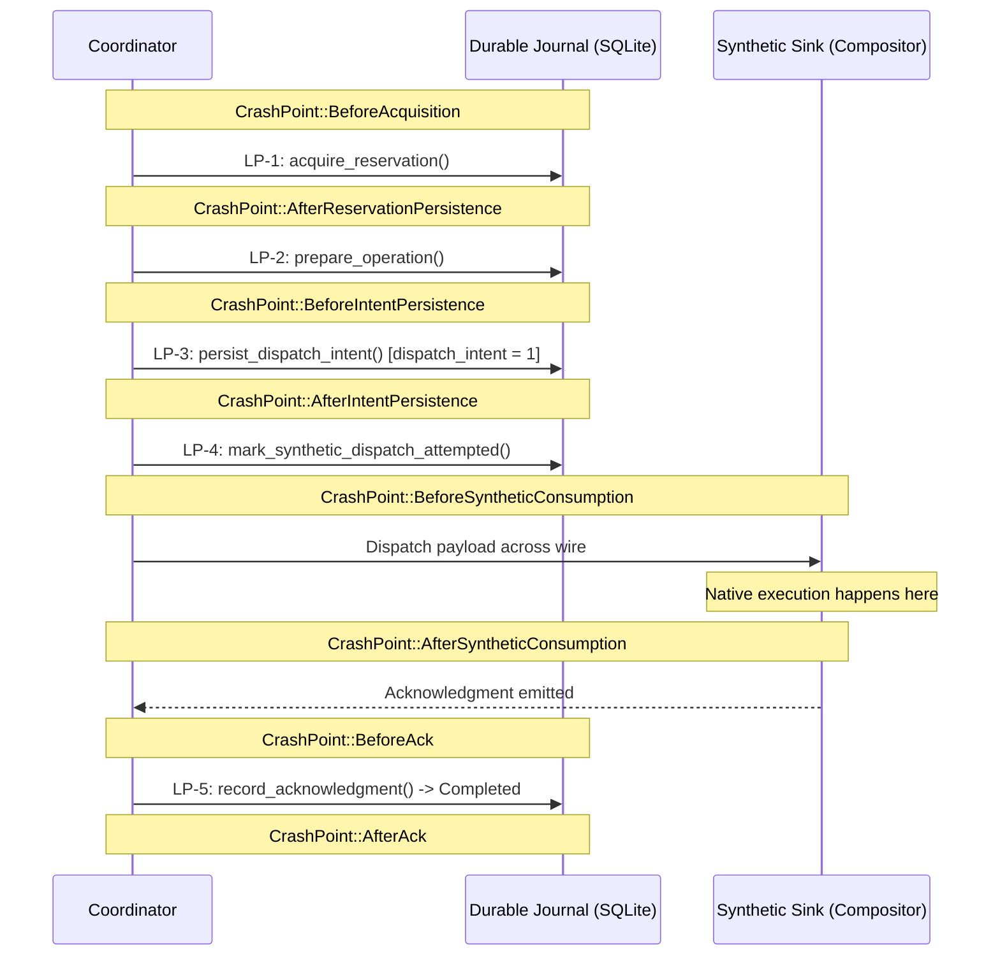
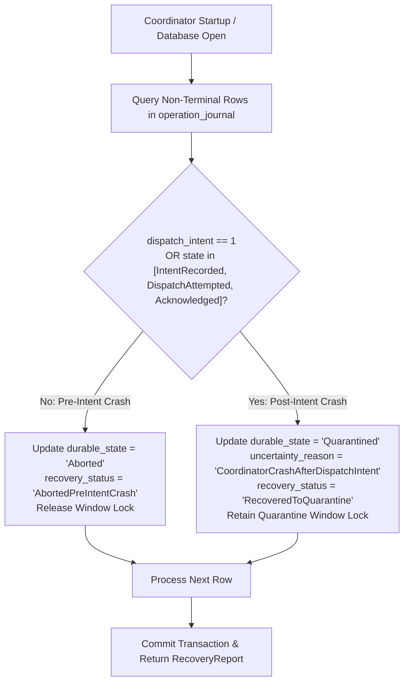
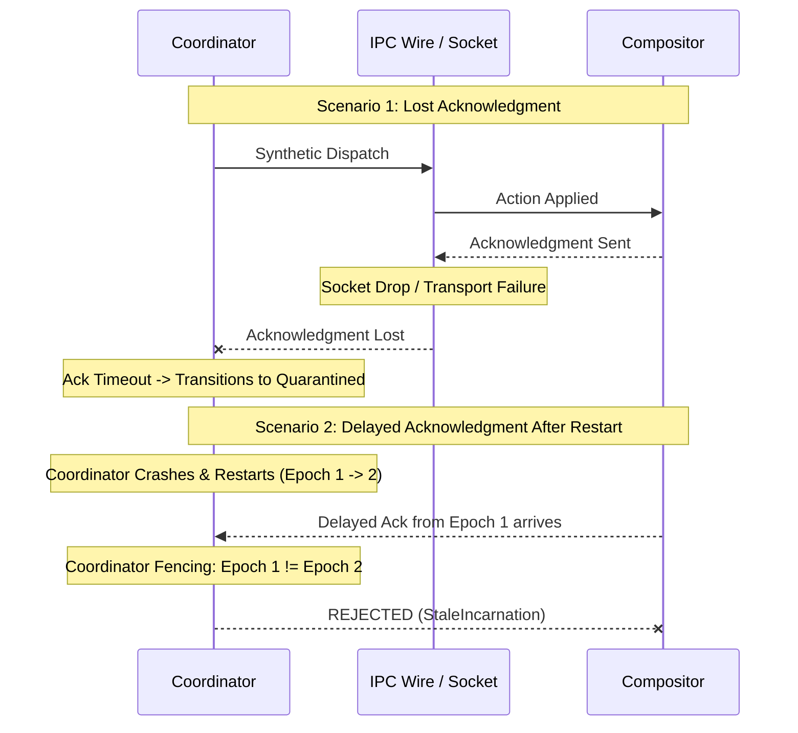

# Phase 3.9 Crash Consistency, Fault Recovery & Lost Acknowledgment Protocol

**Author**: DepthOS Phase 3.9 Architecture & Implementation Engineer (Agent 1)  
**Workspace**: `/home/ashenix/Projects/DepthOS-phase-3-9`  
**Git Branch**: `codex/phase-3-9`  
**Classification Date**: November 2026  
**Status**: Formal Fault Analysis, Recovery Protocol & Qualification Specification  

---

## Executive Summary

Phase 3.9 specifies and verifies the crash-consistency model, failure classification matrix, and lost acknowledgment recovery protocols for DepthOS action security. This document details:
1. **Crash Classification Matrix (Classes A-E)**: Formal qualification of failure modes, verifying Classes A through D while explicitly classifying **Class E (Hardware Power-Loss Safety) as FORMALLY UNSUPPORTED** within virtualized and CI testbeds.
2. **Crash-Cut Injection Points**: Controlled simulated failure injection across eight critical phases of the operation lifecycle.
3. **Startup Recovery Protocol**: Deterministic classification of unfinished operations upon coordinator restart—safely aborting pre-intent operations while permanently quarantining post-intent operations.
4. **Lost, Delayed & Conflicting Acknowledgment Fencing**: Asymmetric network/IPC fault handling that strictly prevents duplicate execution or uncoordinated retries.
5. **Authoritative Reconciliation Protocol**: Explicit, deny-only recovery gateway requiring out-of-band observer evidence to unlock quarantined desktop resources.

---

## 1. Crash & Fault Classification Matrix



### Detailed Failure Classes

| Class | Fault Domain | Mechanics | Protocol Defense | Verification Status |
|---|---|---|---|:---:|
| **Class A** | Simulated Fault Points | Synthetic error injected via `CrashPoint` enum at LP 1-6. | Atomic transaction rollback; database remains cleanly consistent. | **VERIFIED** |
| **Class B** | Process Termination | Unclean process death (`SIGKILL`, segfault, panic). | SQLite WAL recovery cleans journal on next open; `recover_on_startup()` cleans in-flight rows. | **VERIFIED** |
| **Class C** | Concurrency Contention | Multiple coordinator threads or processes racing on database. | `TransactionBehavior::Immediate` acquires exclusive write locks upfront; `busy_timeout = 5000`. | **VERIFIED** |
| **Class D** | Data Corruption | Mismatched schemas, corrupted JSON payloads, or truncated strings. | Database deserializers fail closed with `DurableError::Database`; corrupted operations quarantine window. | **VERIFIED** |
| **Class E** | Sudden Hardware Power Loss | Host power brownout, unplugged cord, host kernel panic. | Relies on disk hardware honoring `fsync`/`fdatasync` through volatile write caches with Power Loss Protection (PLP). | **FORMALLY UNSUPPORTED** |

### Formal Qualification on Class E (Power-Loss Safety)
> **FORMAL SPECIFICATION NOTICE**:  
> In compliance with the DepthOS security contract, **Class E Power-Loss Safety is formally classified as UNSUPPORTED**.  
> Virtual machines, containerized test runners, and standard developer workstations cannot physically test or guarantee bare-metal SSD/NVMe drive controller flush behavior, barrier enforcement, or volatile controller cache battery backup (PLP). While SQLite WAL mode with `PRAGMA synchronous = NORMAL` provides standard operating-system-level crash consistency, DepthOS explicitly disclaims hardware power-cut safety without bare-metal hardware validation.

---

## 2. Crash-Cut Injection Matrix (Section 3.E)

The protocol defines eight discrete crash points in `src/action_security/durable.rs`:

```rust
pub enum CrashPoint {
    None,
    BeforeAcquisition,
    AfterReservationPersistence,
    BeforeIntentPersistence,
    AfterIntentPersistence,
    BeforeSyntheticConsumption,
    AfterSyntheticConsumption,
    BeforeAck,
    AfterAck,
    DuringQuarantine,
    DuringRecovery,
}
```



### Crash Evaluation Matrix

| Simulated Crash Point | `dispatch_intent` Persisted? | Payload Sent on Wire? | Startup Recovery Result | Window Status on Recovery |
|---|:---:|:---:|---|---|
| `BeforeAcquisition` | No | No | No database record created | Available |
| `AfterReservationPersistence` | No | No | `Aborted` (`AbortedPreIntentCrash`) | Available |
| `BeforeIntentPersistence` | No | No | `Aborted` (`AbortedPreIntentCrash`) | Available |
| `AfterIntentPersistence` | **Yes** | No | `Quarantined` (`RecoveredToQuarantine`) | **Quarantined** |
| `BeforeSyntheticConsumption` | **Yes** | Yes (in-flight) | `Quarantined` (`RecoveredToQuarantine`) | **Quarantined** |
| `AfterSyntheticConsumption` | **Yes** | Executed | `Quarantined` (`RecoveredToQuarantine`) | **Quarantined** |
| `BeforeAck` | **Yes** | Executed | `Quarantined` (`RecoveredToQuarantine`) | **Quarantined** |
| `AfterAck` | **Yes** | Completed | `Completed` (already persisted) | Available |

---

## 3. Startup Crash Recovery Protocol (`recover_on_startup`)

Upon process startup or restart, before accepting any new lease acquisitions, the coordinator executes `recover_on_startup()` inside an immediate transaction:

```sql
SELECT operation_id, dispatch_intent, durable_state 
FROM operation_journal 
WHERE durable_state NOT IN ('Completed', 'Aborted', 'Reconciled');
```



### Recovery Principles
1. **Pre-Intent Crash Safety**: If `dispatch_intent == 0`, no execution command could have been placed on the IPC wire. The operation is guaranteed never to have reached the compositor. It is transitioned to `Aborted`, releasing the target window for subsequent operations without spurious quarantines.
2. **Post-Intent Uncertainty**: If `dispatch_intent == 1`, the coordinator cannot determine whether the compositor executed the operation or crashed mid-execution. In accordance with the Two Generals' Problem, the operation **must** transition to `Quarantined`, locking the window against all future mutations.
3. **No Automatic Redispatch**: The coordinator shall never automatically re-issue an operation that was in-flight during a crash. Re-issuing an operation risks executing a desktop move twice (e.g. moving a window to desktop 2, then moving it again).

---

## 4. Lost, Delayed & Conflicting Acknowledgments (Section 3.F)

The wire transport between the coordinator and compositor is an asynchronous channel susceptible to drops, delay, and reordering.



### Protocol Responses to Acknowledgment Anomalies

1. **Dropped Acknowledgment**:
   - The coordinator monotonic timer advances past `expires_at_tick`.
   - The lease transitions from `SyntheticDispatchAttempted` to `Quarantined`.
   - The window remains locked in quarantine. Any caller retry attempt with the same `operation_id` returns `DurableError::Replay`. Any caller attempt with a new `operation_id` targeting the same window returns `DurableError::WindowQuarantined`.
2. **Duplicate Acknowledgment**:
   - The first acknowledgment transitions the state to `Completed`.
   - When a duplicate acknowledgment arrives, the absorbing terminal property rejects the mutation with `DurableError::TerminalState(Completed)`. The duplicate has zero effect on database or compositor state.
3. **Delayed Acknowledgment After Restart**:
   - If the coordinator crashes and restarts, it allocates a fresh `coordinator_incarnation` and increments `coordinator_epoch`.
   - When an acknowledgment from the previous incarnation arrives, the coordinator verifies the packet's `coordinator_incarnation` and `coordinator_epoch`. Because they do not match the active session, the acknowledgment is rejected with `DurableError::CoordinatorMismatch`.
4. **Compositor Incarnation Mismatch**:
   - If KWin restarts while an operation is in flight, the compositor authority issues a new `compositor_incarnation`.
   - When a stale acknowledgment from the old compositor arrives, it is rejected with `DurableError::CompositorMismatch`.
5. **Conflicting Acknowledgment**:
   - If conflicting acks arrive (e.g., an `Applied` followed by a `Rejected`), the first ack establishes the immutable terminal outcome. The conflicting ack is rejected as a terminal state violation.

---

## 5. Authoritative Reconciliation Gateway (Section 3.G)

Quarantine is a fail-closed protective lock. A quarantined window cannot be modified by any coordinator proposal until an authoritative reconciliation occurs.

### Reconciliation Requirements
To reconcile a quarantined operation, the caller must supply valid `ReconciliationEvidence`:

```rust
pub struct ReconciliationEvidence {
    pub observer_incarnation: Uuid,
    pub observer_sequence: u64,
    pub verified_window_key: WindowKey,
    pub observed_native_uuid: Uuid,
    pub observed_placement: Placement,
    pub authoritative_decision: String,
}
```

### Verification Criteria
1. `verified_window_key`: Must match the quarantined operation's `window_key` exactly.
2. `observed_native_uuid`: Must match the quarantined operation's `native_uuid`.
3. `authoritative_decision`: Must contain an explicit, non-whitespace audit justification (e.g. `"ConfirmedAppliedByObserverSnapshot"`).
4. If any criterion fails, `reconcile_quarantine()` returns `DurableError::ReconciliationRejected` and the window remains locked.
5. On successful verification:
   - `durable_state` transitions to `Reconciled`.
   - Serialized evidence is permanently recorded in `reconciliation_evidence`.
   - `recovery_status` is updated to `'AuthoritativelyReconciled'`.
   - Target window exclusion is finally released (LP-8).

---

## 6. Verification & Test Matrix

All crash, recovery, and acknowledgment invariants are verified by automated deterministic integration tests:

| Test File | Test Name | Invariants Verified | Result |
|---|---|---|:---:|
| `tests/durable_coordinator.rs` | `test_crash_points_matrix_consistency` | Pre-intent aborts, post-intent quarantines, 8 crash points. | **PASS** |
| `tests/durable_coordinator.rs` | `test_lost_acknowledgment_triggers_quarantine_and_denies_redispatch` | Lost ack, quarantine window lock, replay denial. | **PASS** |
| `tests/durable_coordinator.rs` | `test_duplicate_and_delayed_ack_handling` | Terminal absorbing, duplicate ack rejection, stale incarnation. | **PASS** |
| `tests/durable_coordinator.rs` | `test_authoritative_reconciliation_workflow` | Bogus evidence rejection, valid evidence reconciliation, window unlock. | **PASS** |
| `tests/durable_coordinator.rs` | `test_monotonic_incarnation_epochs_across_restarts` | Strict monotonic epoch allocation across 5 restarts. | **PASS** |
| `src/action_security/durable.rs` | 13 Unit Tests in `mod tests` | State machine legal transitions, absorbing states, intent precedes dispatch. | **PASS** |

**Zero sleep statements or timing heuristics** are used; all tests execute deterministically against SQLite in-memory and isolated temporary databases.
