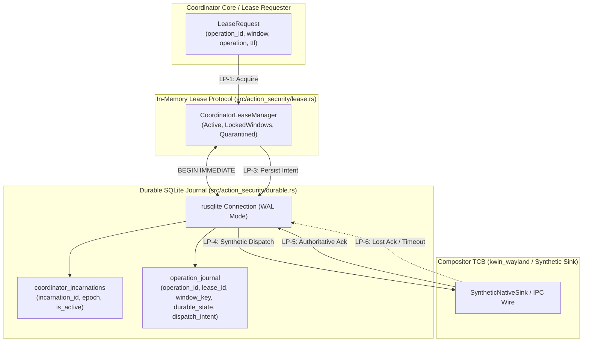
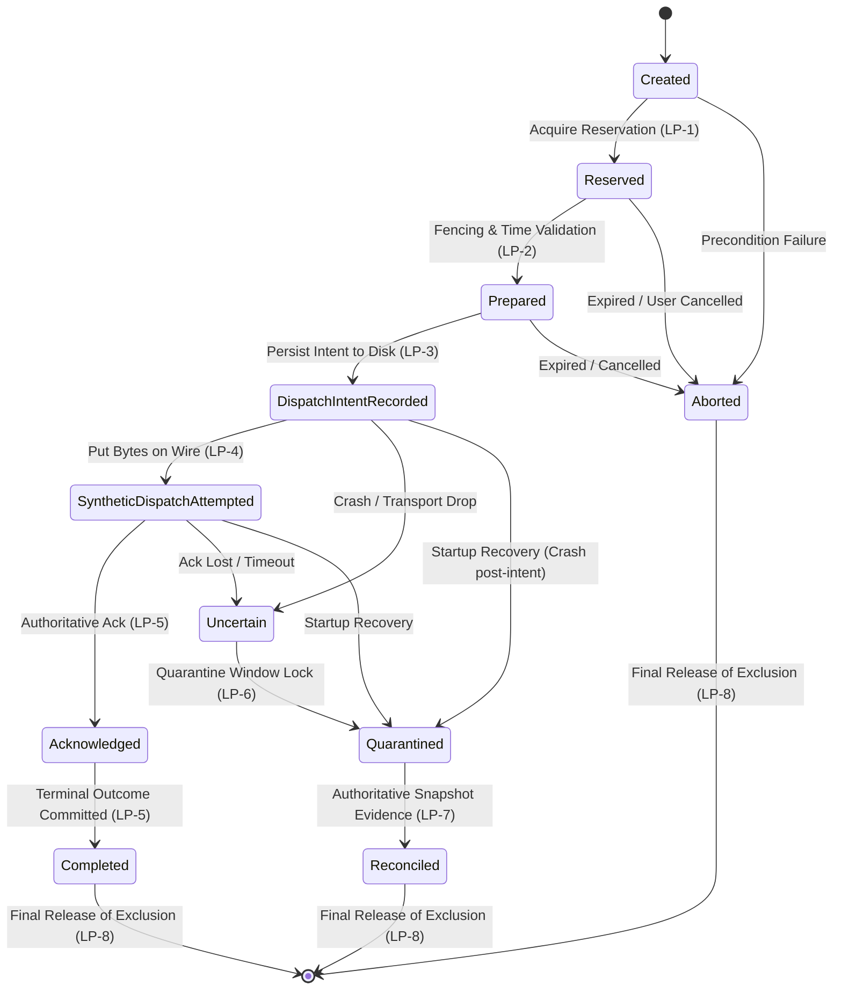

# Phase 3.9 Durable Operation Journal & State Machine Specification

**Author**: DepthOS Phase 3.9 Architecture & Implementation Engineer (Agent 1)  
**Workspace**: `/home/ashenix/Projects/DepthOS-phase-3-9`  
**Git Branch**: `codex/phase-3-9`  
**Classification Date**: November 2026  
**Status**: Formal Implementation Architecture and Protocol Specification  

---

## Executive Summary

Phase 3.9 implements the Durable Coordinator Protocol and Operation Journal for DepthOS action security. This protocol bridges the gap between in-memory coordinator reservations (Phase 3.8 `CoordinatorLeaseManager`) and durable on-disk write-ahead logging (WAL). It provides:
1. **Durable Operation Journaling**: An ACID SQLite database recording all operation parameters, incarnation boundaries, and state transitions using prepared statements and immediate transactions.
2. **Replay Immunity Across Restarts**: Guarantees that an `operation_id` can never be reused or re-executed, surviving process terminations and reboots.
3. **Formal 11-State Operation State Machine**: Explicit legal transition matrix ensuring terminal states are absorbing and uncertain states require authoritative reconciliation before windows can be unlocked.
4. **Eight Formal Linearization Points**: Unambiguous synchronization barriers defining when exclusion is acquired, fenced, persisted, dispatched, acknowledged, quarantined, reconciled, and released.
5. **Deny-Only Default**: In accordance with the project security contract, production action capability minting remains permanently disabled.

---

## 1. Durable Journal Architecture & SQLite Schema

The durable journal is implemented in `src/action_security/durable.rs` via `DurableOperationJournal` and integrated with in-memory leases via `DurableCoordinatorSession`.



### SQLite Schema Definition

The database executes under WAL mode with `PRAGMA synchronous = NORMAL`, `PRAGMA foreign_keys = ON`, and `PRAGMA busy_timeout = 5000`.

```sql
CREATE TABLE IF NOT EXISTS coordinator_incarnations (
    incarnation_id TEXT PRIMARY KEY,
    epoch INTEGER NOT NULL UNIQUE,
    created_at_ms INTEGER NOT NULL,
    is_active INTEGER NOT NULL DEFAULT 1
);

CREATE TABLE IF NOT EXISTS operation_journal (
    operation_id TEXT PRIMARY KEY,
    lease_id TEXT NOT NULL UNIQUE,
    window_key TEXT NOT NULL,
    native_uuid TEXT NOT NULL,
    operation_type TEXT NOT NULL,
    operation_json TEXT NOT NULL,
    coordinator_incarnation TEXT NOT NULL,
    coordinator_epoch INTEGER NOT NULL,
    checkpoint_epoch TEXT NOT NULL,
    checkpoint_sequence INTEGER NOT NULL,
    observer_incarnation TEXT NOT NULL,
    observer_version_seq INTEGER NOT NULL,
    policy_revision TEXT NOT NULL,
    topology_revision TEXT NOT NULL,
    compositor_incarnation TEXT NOT NULL,
    durable_state TEXT NOT NULL,
    created_at_tick INTEGER NOT NULL,
    expires_at_tick INTEGER NOT NULL,
    dispatch_intent INTEGER NOT NULL DEFAULT 0,
    terminal_outcome TEXT,
    uncertainty_reason TEXT,
    reconciliation_evidence TEXT,
    reconciled_at_tick INTEGER,
    recovery_status TEXT NOT NULL DEFAULT 'None',
    created_at_ms INTEGER NOT NULL,
    updated_at_ms INTEGER NOT NULL
);

CREATE INDEX IF NOT EXISTS idx_journal_window ON operation_journal(window_key);
CREATE INDEX IF NOT EXISTS idx_journal_state ON operation_journal(durable_state);
CREATE INDEX IF NOT EXISTS idx_journal_lease ON operation_journal(lease_id);
```

### Table Column Invariants
- `operation_id`: Globally unique identifier (`RequestId`). Primary key ensures replay attempts are rejected at the database engine level.
- `lease_id`: Globally unique lease reservation identifier (`LeaseId`). Unique constraint prevents lease identifier collision.
- `window_key`: Full JSON serialization of `WindowKey` (epoch, runtime_id, generation).
- `dispatch_intent`: Boolean flag ($0$ or $1$). Must be committed to disk as $1$ before any dispatch message is placed on the wire.
- `durable_state`: Current state machine phase.
- `terminal_outcome`: `Applied` or `Rejected` when state is `Completed`.

---

## 2. Formal Operation State Machine

The state machine consists of eleven explicit states:



### State Definitions

| State | Classification | Persisted in SQLite? | Semantics |
|---|---|:---:|---|
| `Created` | Ephemeral | No (or transient) | Operation request initialized, awaiting reservation. |
| `Reserved` | In-Flight / Active | Yes | Reservation acquired, window locked against concurrent proposals. |
| `Prepared` | In-Flight / Active | Yes | Fencing verified (coordinator epoch, compositor incarnation, deadline). |
| `DispatchIntentRecorded` | Committed Intent | Yes | `dispatch_intent = 1` committed to SQLite WAL. Dispatch cannot be rolled back. |
| `SyntheticDispatchAttempted` | In-Flight / Wire | Yes | Payload dispatched to synthetic sink / compositor actor. |
| `Acknowledged` | In-Flight / Wire | Yes | Authoritative acknowledgment received from compositor. |
| `Completed` | Terminal (Absorbing) | Yes | Terminal outcome (`Applied` or `Rejected`) persisted. Window released. |
| `Uncertain` | Transient Fault | Yes | Lost acknowledgment, transport disconnect, or post-intent crash. |
| `Quarantined` | Durable Lockdown | Yes | Window permanently locked against coordinator mutations until reconciled. |
| `Reconciled` | Terminal (Absorbing) | Yes | Authoritative external evidence verified. Window unlocked. |
| `Aborted` | Terminal (Absorbing) | Yes | Cancelled or expired prior to dispatch intent. Window unlocked. |

### Invariant Rules
1. **Absorbing Terminal States**: `Completed`, `Aborted`, and `Reconciled` are strictly absorbing. Any transition out of these states returns `DurableError::TerminalState` or `DurableError::InvalidTransition`.
2. **Intent Barrier**: An operation cannot transition to `SyntheticDispatchAttempted` without first persisting `DispatchIntentRecorded`.
3. **No Automatic Retry of Uncertain Operations**: An operation that reaches `Uncertain` or `Quarantined` can never transition back to `Prepared` or `DispatchIntentRecorded`. The Two Generals' Problem prohibits assuming non-execution.

---

## 3. Eight Formal Linearization Points (LP 1-8)

To eliminate race conditions and enforce deterministic concurrency, the protocol establishes eight unambiguous linearization points:

```
[LP-1: Acquire] -> [LP-2: Fence] -> [LP-3: Intent] -> [LP-4: Dispatch] -> [LP-5: Ack / Complete]
                                                                  |
                                                           [LP-6: Quarantine]
                                                                  |
                                                          [LP-7: Reconcile]
                                                                  |
                                                      [LP-8: Release Exclusion]
```

### LP-1: Reservation Acquisition
- **Action**: Atomically locks the target window and persists initial lease parameters.
- **Transaction**: `BEGIN IMMEDIATE` on `operation_journal`.
- **Preconditions**:
  * `operation_id` does not exist in `operation_journal` (Replay check).
  * Target `window_key` is not locked by any active or quarantined row:
    $$\forall r \in \text{operation\_journal}, \quad r.\text{window\_key} = w \implies r.\text{durable\_state} \in \{\text{Completed}, \text{Aborted}, \text{Reconciled}\}$$
- **Postconditions**: Row inserted with `durable_state = 'Reserved'`. Window is locked against concurrent coordinator mutations.

### LP-2: Lease Fencing & Preparation
- **Action**: Verifies version and incarnation invariants immediately prior to committing intent.
- **Preconditions**:
  * Active `coordinator_incarnation` and `coordinator_epoch` match reservation.
  * Active `compositor_incarnation` matches reservation.
  * Current monotonic `Tick < expires_at_tick`.
- **Postconditions**: Transitions `Reserved -> Prepared`.

### LP-3: Dispatch-Intent Persistence
- **Action**: Commits immutable intent to execute into SQLite WAL.
- **Transaction**: `BEGIN IMMEDIATE` updating `durable_state = 'DispatchIntentRecorded'` and `dispatch_intent = 1`.
- **Preconditions**: State is `Prepared`; monotonic deadline has not elapsed.
- **Postconditions**: Intent is durably committed to disk. If a crash occurs after this moment, startup recovery **must** treat execution as potentially occurred.

### LP-4: Synthetic Dispatch Attempt
- **Action**: Dispatches execution payload across the IPC wire boundary to the compositor actor.
- **Preconditions**: `dispatch_intent == true`; state is `DispatchIntentRecorded`.
- **Postconditions**: Transitions `DispatchIntentRecorded -> SyntheticDispatchAttempted`.

### LP-5: Acknowledgment Recording & Completion
- **Action**: Authoritative compositor acknowledgment is processed and committed.
- **Transaction**: `BEGIN IMMEDIATE` updating `durable_state = 'Acknowledged'` and atomically to `Completed` with `terminal_outcome` (`Applied` or `Rejected`).
- **Preconditions**: Compositor incarnation matches active authority; state is `SyntheticDispatchAttempted`.
- **Postconditions**: Terminal outcome recorded. Window exclusion is released.

### LP-6: Uncertainty Quarantine
- **Action**: On lost acknowledgment, IPC timeout, transport disconnect, or post-intent crash, locks the window into quarantine.
- **Transaction**: `BEGIN IMMEDIATE` updating `durable_state = 'Quarantined'` with `uncertainty_reason`.
- **Preconditions**: Operation has committed dispatch intent, but outcome cannot be authoritatively proven.
- **Postconditions**: Target window is locked against all future coordinator mutations.

### LP-7: Authoritative Reconciliation
- **Action**: Evaluates external independent snapshot evidence to resolve quarantined operations.
- **Transaction**: `BEGIN IMMEDIATE` updating `durable_state = 'Reconciled'` with serialized `reconciliation_evidence`.
- **Preconditions**:
  * Evidence matches target `window_key` and observed `native_uuid`.
  * Authoritative decision string is non-empty.
- **Postconditions**: Operation reaches terminal `Reconciled` state.

### LP-8: Final Release of Exclusion
- **Action**: Target window becomes available for subsequent coordinator operations.
- **Preconditions**: All operations for the target window have reached a terminal state (`Completed`, `Aborted`, or `Reconciled`).
- **Postconditions**: `check_window_available(&window)` returns `Ok(())`.

---

## 4. Concurrency, Replay Immunity & Fencing

### Replay Immunity
Replay immunity is guaranteed at both the database and memory levels:
1. `operation_id` is the primary key in `operation_journal`. Any attempt to insert an existing `operation_id` returns SQLite constraint error, mapped to `DurableError::Replay`.
2. Even after coordinator restarts and database re-openings, historical rows remain in `operation_journal`, permanently forbidding ID reuse.

### Concurrency and Immediate Locking
By utilizing SQLite `TransactionBehavior::Immediate`, write transactions acquire the database reserved lock upfront, eliminating deadlock risks caused by deferred lock escalation under high concurrent reader/writer loads.

### Monotonic Incarnation Fencing
The `coordinator_incarnations` table guarantees that every coordinator startup receives a monotonically increasing epoch:
$$\text{Epoch}_{N+1} = \max(\text{Epoch}_{1..N}) + 1$$
Any in-flight message or delayed response from an earlier epoch is rejected with `DurableError::CoordinatorMismatch` or `DurableError::StaleIncarnation`.

---

## 5. Security Posture Summary

The Durable Operation Journal satisfies all requirements of Section 3 of Phase 3.9:
- Zero capability issuance in production mode.
- Strict write-ahead logging before dispatch.
- Fail-closed window quarantine on uncertainty.
- Total replay prevention across restarts.
