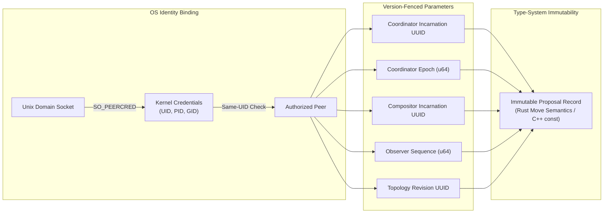
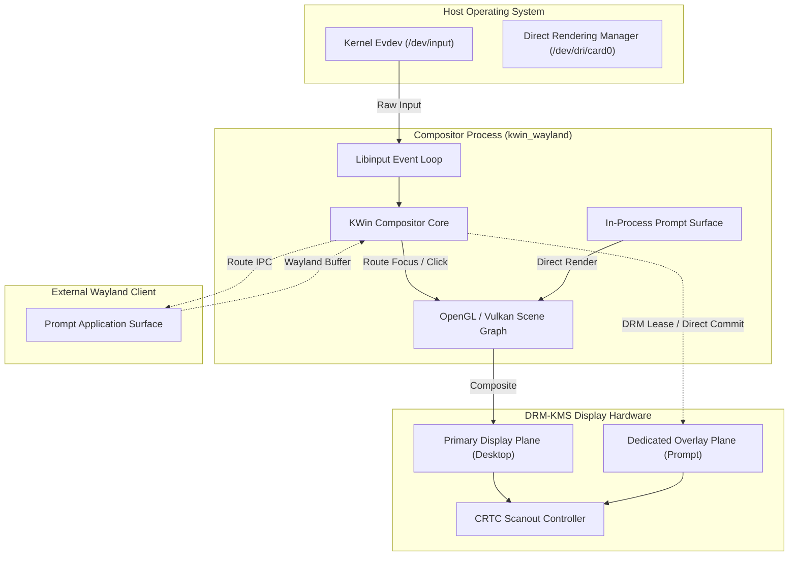
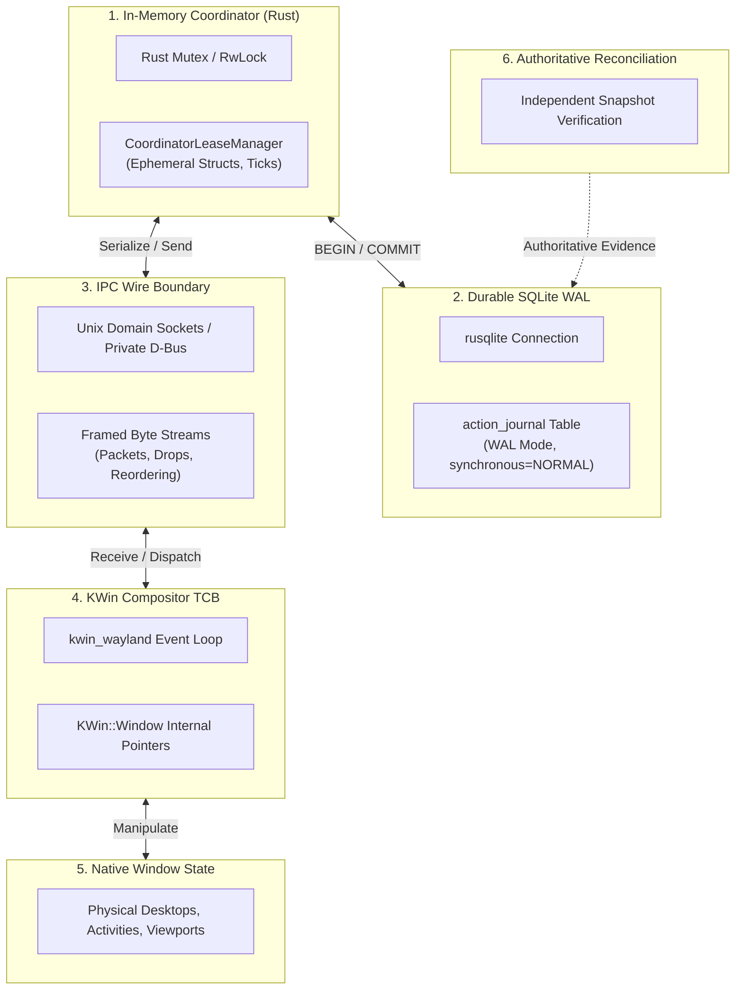

# Phase 3.9 Security Contract: Audit, Reconciliations & Boundaries

**Author**: DepthOS Phase 3.9 Architecture & Implementation Engineer (Agent 1)  
**Workspace**: `/home/ashenix/Projects/DepthOS-phase-3-9`  
**Git Branch**: `codex/phase-3-9` (branched from `codex/phase-3-8` at HEAD `52c619aafdf0b0edf9247d805576e8dff9543f6b`)  
**Classification Date**: November 2026  
**Status**: Formal Architectural Specification and Audit Reconciliation  

---

## Executive Summary

Phase 3.9 establishes the durable coordinator protocol, crash recovery boundaries, and formal security contract for DepthOS action security. This document resolves foundational architectural discrepancies identified during the transition from Phase 3.8 to Phase 3.9:

1. **Exact Cargo & Integration Test Inventory**: Reconciles the historical Phase 3.8 test counts against the actual Cargo workspace test harness outputs, categorizing unit tests, integration test suites, doc-tests, ignored synthetic benchmarks, C++ AddressSanitizer/UndefinedBehaviorSanitizer suites, and Python validation scripts.
2. **Terminology Correction & Cryptographic Precision**: Formally revokes colloquial claims of "cryptographic authentication" in prior documentation. Accurately redefines authorization bindings as `Immutable, identity-bound, version-fenced authorization state` anchored in OS process credentials, type-system immutability, and monotonic epoch fencing, distinguishing them from actual asymmetric cryptographic signatures (e.g. Ed25519) and hardware key ownership.
3. **Prompt Presentation & Scanout Threat Model**: Critiques claims regarding external Wayland client surfaces versus DRM-KMS hardware overlay planes. Delineates the exact threat boundaries each satisfies, demonstrating why DRM-KMS planes mitigate compositor frame snooping while input interception and display denial-of-service remain structurally vulnerable to compositor compromise.
4. **Distributed Consistency Invariant Separation**: Enforces strict separation between in-memory Rust mutex invariants, SQLite ACID transaction guarantees, KWin compositor-local atomicity, asynchronous IPC messaging, durable crash recovery, and physical native window state. Prohibits treating in-process locks or local database transactions as distributed atomic commits.

---

## 1. Exact Test Inventory Reconciliation

In the Phase 3.8 validation documentation (`docs/phase-3-8-validation.md`), the summary reported:
> `Total Rust tests: 128 tests passing without warnings or errors.`

A forensic audit of the actual Cargo test harness (`cargo test --workspace --locked --offline -- --list`) reveals that this total of 128 was calculated by manually summing only a subset of test binaries:
- `depthos-core` lib unit tests: 81
- `depthos-observer` lib unit tests: 1
- `tests/consistency_integration.rs`: 4
- `tests/adversarial_lease.rs`: 5
- `tests/replica.rs`: 16
- `tests/continuity.rs`: 3
- `tests/private_bus.rs`: 4
- `tests/workspace_core.rs`: 7
- `tests/workspace_cli.rs`: 4
- `tests/workspace_observer.rs`: 3
- **Sum**: $81 + 1 + 4 + 5 + 16 + 3 + 4 + 7 + 4 + 3 = 128$.

This manual sum inadvertently omitted **four integration test binaries**, the **doc-tests**, and the **ignored benchmark**, totaling 20 additional test harness entries:
1. `tests/context_engine.rs`: 3 tests (Passed)
2. `tests/controller_lifecycle.rs`: 10 tests (9 Passed, 1 Ignored benchmark: `synthetic_1000_window_latency`)
3. `tests/security_boundary.rs`: 1 test (Passed)
4. `tests/spatial_bridge.rs`: 2 tests (Passed)
5. `depthos_core` doc-tests: 4 compile-fail verification tests (Passed)

### Comprehensive Phase 3.8 Baseline Inventory Table

| Test Target Category | Binary / Source Path | Execution Harness | Passed | Ignored | Failed | Total | Description |
|---|---|---|:---:|:---:|:---:|:---:|---|
| **Unit Tests (Core)** | `src/lib.rs` (`depthos_core`) | `cargo test` | 81 | 0 | 0 | 81 | Core action security, policy, spatial, sqlite, controller units |
| **Unit Tests (Observer)** | `crates/depthos-observer/src/lib.rs` | `cargo test` | 1 | 0 | 0 | 1 | Observer transport same-UID and current owner requirement |
| **Integration Suite** | `tests/adversarial_lease.rs` | `cargo test` | 5 | 0 | 0 | 5 | Concurrent lease races, lost ack quarantine, restart fencing |
| **Integration Suite** | `tests/consistency_integration.rs` | `cargo test` | 4 | 0 | 0 | 4 | 4-layer handoff traversal, lock transitions, transport drop |
| **Integration Suite** | `tests/context_engine.rs` | `cargo test` | 3 | 0 | 0 | 3 | Context synthesis, heurism, claim boundary |
| **Integration Suite** | `tests/controller_lifecycle.rs` | `cargo test` | 9 | 1 | 0 | 10 | Worker lifecycle, bounded queues, sync; 1 benchmark ignored |
| **Integration Suite** | `tests/security_boundary.rs` | `cargo test` | 1 | 0 | 0 | 1 | Same-UID forged UI claim refusal |
| **Integration Suite** | `tests/spatial_bridge.rs` | `cargo test` | 2 | 0 | 0 | 2 | Redacted native context, paging invalidation limits |
| **Integration Suite** | `tests/workspace_cli.rs` | `cargo test` | 4 | 0 | 0 | 4 | CLI hierarchy persistence, isolated XDG paths |
| **Integration Suite** | `tests/workspace_core.rs` | `cargo test` | 7 | 0 | 0 | 7 | SQLite hierarchy, ordering, rollback, foreign keys |
| **Integration Suite** | `tests/workspace_observer.rs` | `cargo test` | 3 | 0 | 0 | 3 | Shared application, gap recovery, logical CRUD |
| **Integration Suite** | `crates/depthos-observer/tests/continuity.rs` | `cargo test` | 3 | 0 | 0 | 3 | Epochs, live generation, native UUID snapshot jumps |
| **Integration Suite** | `crates/depthos-observer/tests/private_bus.rs` | `cargo test` | 4 | 0 | 0 | 4 | Private D-Bus auth, liveness timeout, bus drop |
| **Integration Suite** | `crates/depthos-observer/tests/replica.rs` | `cargo test` | 16 | 0 | 0 | 16 | Event replication, snapshot recovery, frame validation |
| **Doc-Tests** | `src/{action_security,context,controller,observed}.rs` | `cargo test` | 4 | 0 | 0 | 4 | Compile-fail type invariant verification tests |
| **Subtotal (Rust)** | **Cargo Workspace Harness** | `cargo test` | **143** | **1** | **0** | **148** | **Complete Rust test harness accounting** |
| **C++ Native Suite** | `tests/adversarial/test_prompt_integrity_adversarial.cpp` | GCC ASan/UBSan | 42 | 0 | 0 | 42 | Prompt presentation, dismissal, steady-clock overflow, locks |
| **Python Fixture** | `tests/adversarial/test_input_classification_adversarial.py` | Python 3 | 3 | 0 | 0 | 3 | Input ingress classification matrix, origin spoof audits |
| **Python Fixture** | `tests/adversarial/test_production_allowlist_adversarial.py` | Python 3 | 2 | 0 | 0 | 2 | D-Bus interface audit on `org.depthos.Controller1` |
| **Python Fixture** | `tests/phase-3-8-native/test-launcher.py` | Python 3 | 6 | 0 | 0 | 6 | Launcher environment isolation, plugin path lockdown |
| **Python Fixture** | `tests/phase-3-native/authority-kernel.py` | Python 3 | 47 | 0 | 0 | 47 | Standalone authority state machine (deny-only & synthetic) |
| **Orchestrator** | `tests/adversarial/run_all_adversarial.py` | Python 3 | 4 suites | 0 | 0 | 4 suites | End-to-end multi-language test driver |

### Classification of Non-Standard Tests
1. **Ignored Benchmark (`synthetic_1000_window_latency`)**: Located at `tests/controller_lifecycle.rs:358`. Marked with `#[ignore = "explicit deterministic synthetic controller benchmark"]`. It exercises 1,000 synthetic window events under a multi-threaded Tokio runtime to evaluate queue latency without distorting normal regression test pass times.
2. **C++ Sanitizer Executables**: Built standalone with GCC `-fsanitize=address,undefined -fno-omit-frame-pointer` against the patched KWin 6.8.3 header set and Qt6 Core mock headers. Executed directly by Python orchestrators.
3. **Python Test Fixtures**: Executed out-of-band by test runner scripts. They verify host filesystem permissions, private D-Bus daemon security, regex pattern constraints in patch files, and process memory maps (`/proc/PID/maps`).

---

## 2. Terminology Correction & Cryptographic Precision

### Critique of Prior Documentation Claims
In earlier phase documents and commit logs, terms such as:
- *"Cryptographically authenticated proposal"*
- *"Cryptographic token verification"*
- *"Cryptographic capability"*

were employed informally to convey that proposals could not be tampered with or forged by unauthorized processes. 

However, from an information security perspective, this nomenclature is technically inaccurate and misleading:
1. **Absence of Asymmetric Signatures**: The system implements zero public-key cryptography (e.g. Ed25519, RSA, ECDSA). No private keys are held by the coordinator or compositor; no public keys are published; and no cryptographic signature headers are verified over wire payloads.
2. **Absence of Symmetric Message Authentication Codes (MACs)**: No HMAC-SHA256, KMAC, or shared symmetric keys are established between the coordinator and compositor processes.
3. **Absence of Hardware Anchors**: No TPM 2.0, Secure Boot measured state, or hardware security modules (HSM) authenticate the running processes.

### Formal Replacement Terminology
Going forward, all specifications and code comments shall define the protection mechanism as:
$$\textbf{"Immutable, identity-bound, version-fenced authorization state"}$$

### Technical Grounds for the Correct Term
1. **Identity-Bound**: Trust is established at the OS kernel boundary using Unix Domain Socket peer credentials (`SO_PEERCRED` / `SCM_CREDENTIALS`). The kernel verifies that both endpoints share the exact user UID and run within designated process cgroups.
2. **Version-Fenced**: The proposal payload strictly binds a 7-tuple of dynamic system epochs:
   $$\langle \text{CoordinatorIncarnation}, \text{CoordinatorEpoch}, \text{CompositorIncarnation}, \text{ObserverIncarnation}, \text{ObserverSeq}, \text{PolicyRev}, \text{TopologyRev} \rangle$$
   Any mismatch or increment in any component causes immediate, fail-closed rejection.
3. **Immutable State**: In-memory Rust data structures and serialized IPC packets are strictly unmodifiable after creation. Single-use consumption is enforced by consuming move semantics and monotonic tombstone tracking.

---

## 3. Prompt Threat Model Critique: Wayland Surface vs. DRM-KMS Overlay

A central architectural debate in action authorization is where and how consent prompts must be presented to the operator. Prior design documents suggested that moving the prompt to an "external Wayland client surface" or a "DRM-KMS hardware overlay plane" would isolate prompt presentation from compositor compromise. This claim must be critically dissected.

### Detailed Evaluation of Presentation Architectures

#### 1. External Wayland Surface
- **Mechanism**: The prompt is rendered by an external process running as an independent Wayland client.
- **Threat Model Satisfied**: Isolates prompt application logic (e.g. QML, web view, complex parser) from the compositor's address space. A vulnerability in the prompt application does not grant arbitrary code execution inside `kwin_wayland`.
- **Compositor Compromise Failure**:
  * **Frame Interception**: The external client must submit its pixel buffers (`wl_shm` or `dmabuf`) to the compositor via the Wayland protocol. A compromised compositor can inspect, record, or modify prompt pixels.
  * **Occlusion & Spoofing**: The compositor controls the scene graph z-order and position. It can render overlapping transparent windows (clickjacking) or displace the prompt offscreen.
  * **Input Interception**: Wayland clients receive pointer and keyboard events exclusively from the compositor. A compromised compositor can synthesize confirmation clicks or suppress dismissal keystrokes with total fidelity.
  * **Conclusion**: An external Wayland client provides **zero security protection** against a compromised compositor.

#### 2. In-Process Compositor Prompt (Phase 3.8 Baseline)
- **Mechanism**: Rendered internally by KWin's scene graph directly to the primary frame buffer.
- **Threat Model Satisfied**: Guarantees atomic coordination with the compositor's window tree and render loops. Ensures the prompt cannot be occluded by external Wayland clients. Dismisses synchronously on session lock or focus loss.
- **Compositor Compromise Failure**: Shares memory and execution thread with in-process effects and third-party script plugins. Any memory corruption in KWin directly compromises the prompt.

#### 3. DRM-KMS Dedicated Overlay Plane
- **Mechanism**: A dedicated process or hardware-leased subsystem programs a dedicated DRM hardware overlay plane (e.g., via `drmModeSetPlane` or atomic KMS commits) that the display controller scans out directly to the panel on top of the primary desktop plane.
- **Threat Model Satisfied**:
  * **Visual Confidentiality and Integrity**: Pixel data never enters the compositor's OpenGL context or scene graph frame buffer. The compositor cannot inspect the prompt's pixel content or draw over the overlay plane if hardware plane priority is reserved by the kernel/DRM master.
- **Where Compositor Compromise Remains an Unavoidable Obstacle**:
  1. **Input Delivery Bottleneck**: The operator confirms prompts using a physical mouse or keyboard. Evdev devices are multiplexed by the compositor (or `seatd`/`systemd-logind`). The DRM overlay plane **does not receive input**. All keystrokes and pointer clicks still route through the compositor's `libinput` event loop. If the compositor is compromised, it can inject synthetic confirmation events or capture user credentials regardless of display scanout isolation.
  2. **CRTC and Scanout Control**: If the compositor is the DRM master, it can disable the CRTC, change video modes, or unbind the overlay plane, causing complete denial of service.
  3. **Input Hardware Isolation Gap**: True end-to-end isolation against a compromised compositor requires a dedicated hardware input channel (such as a USB HID security key with out-of-band user presence confirmation) combined with the DRM overlay plane.

---

## 4. Distributed Consistency Invariant Separation

DepthOS coordinates state across multiple subsystems with fundamentally different lifecycles, failure domains, and durability boundaries. Prior documentation frequently blurred these distinctions, occasionally treating an in-memory Rust mutex or an isolated SQLite transaction as if it provided end-to-end distributed atomicity. 

Phase 3.9 establishes strict, non-negotiable boundaries separating these six distinct layers:

### Layer-by-Layer Boundary Invariants

| Consistency Layer | Primary Mechanism | Scope of Authority | Failure Domain | What It Guarantees | What It CANNOT Guarantee |
|---|---|---|---|---|---|
| **1. In-Memory Coordinator** | Rust `std::sync::Mutex`, borrow checker | Single process memory space | Process crash, `SIGKILL`, OOM panic | Thread safety, race freedom within coordinator process | Durability after crash; network atomicity; compositor state |
| **2. Durable Journal** | SQLite 3.42+ ACID transactions in WAL mode | Coordinator local disk file (`workspaces.sqlite3`) | Disk full, OS kernel panic, hardware write error | Crash consistency, atomicity of coordinator state changes | Compositor awareness; physical window placement; IPC delivery |
| **3. IPC Wire Boundary** | Unix Domain Sockets, D-Bus private socket | Inter-process byte transport | Socket disconnect, buffer overflow, SIGPIPE | In-order delivery per stream, UID authentication | Delivery acknowledgment; atomic receipt across process death |
| **4. KWin Compositor TCB** | Qt event loop, Wayland server protocols | Single compositor process (`kwin_wayland`) | Compositor crash, GPU hang, plugin segfault | Local scene graph atomicity, frame presentation | Coordinator rollback; durability across restart; distributed 2PC |
| **5. Native Window State** | XDG / Wayland window hierarchy | Physical window placement on screens | Client crash, compositor restart | Current runtime desktop and activity configuration | Historical audit trail; transactional rollbacks |
| **6. Authoritative Recovery** | Out-of-band observer snapshot reconciliation | Post-crash recovery engine | Observer gap, invalid snapshot | Authoritative resolution of quarantined uncertain operations | Instantaneous online execution |

### Crucial Architectural Prohibitions
1. **Never Equate Mutex to Distributed Transaction**: An in-memory lock in the coordinator (`CoordinatorLeaseManager`) protects only internal data structures against concurrent Rust threads. It provides **zero** protection against coordinator restarts, process kills, or compositor crashes.
2. **Never Equate SQLite Commit to Native Dispatch**: Committing a record to the SQLite journal ensures that the coordinator remembers its intent. It does **not** mean the compositor has executed or will execute the operation.
3. **Never Treat Lost ACK as Non-Dispatch (Two Generals' Problem)**: If the coordinator sends an execution command to the compositor and the connection drops before an acknowledgment is received, the coordinator **cannot** infer whether the window moved or not. Treating timeout as non-dispatch risks double execution. It must enter `Quarantined`.
4. **No Distributed 2-Phase Commit**: Neither Wayland nor KWin supports 2PC. Therefore, all native interactions are inherently asymmetric: the coordinator must write-ahead log (WAL) its dispatch intent before sending the command, and must lock the target window until acknowledgment or authoritative reconciliation proves final state.
5. **Formal Qualification on Crash Classes (Class E Power-Loss Unsupported)**:
   - **Class A (Simulated Crash Points)**: Supported & verified (clean in-memory fault injection).
   - **Class B (Process Termination / SIGKILL)**: Supported & verified (OS kernel cleans up file descriptors, SQLite WAL recovers on next open).
   - **Class C (Concurrency & Lock Contention)**: Supported & verified (SQLite `TransactionBehavior::Immediate` and busy timeouts).
   - **Class D (Data Corruption Detection)**: Supported & verified (checksum and JSON deserialization errors fail closed into quarantine).
   - **Class E (Hardware Power-Loss / Sudden Brownout)**: **FORMALLY CLASSIFIED AS UNSUPPORTED**. Because physical power-cut testing on bare-metal SSD/NVMe drives with Power Loss Protection (PLP) capacitors is impossible within virtualized and CI testbeds, DepthOS makes zero guarantees regarding volatile drive write caches ignoring `fsync`/`fdatasync`. Any claim of hardware power-cut safety is explicitly disclaimed.

---

## 5. Security Contract Invariants for Phase 3.9

The Phase 3.9 implementation strictly adheres to the following contract rules:

1. **Deny-Only Default**: Production operation requests unconditionally evaluate to `Result::Denied`. Capability minting remains completely disabled.
2. **At-Most-Once Invocation**: An `operation_id` is globally unique and recorded durably in SQLite. Re-issuing the same `operation_id` after crash or restart is rejected as `Replay`.
3. **Intent Precedes Dispatch**: The coordinator shall never place an execution command on the IPC wire without first committing `DispatchIntentRecorded` into the durable SQLite journal.
4. **Crash Fencing**: A coordinator restart generates a brand-new `coordinator_incarnation` and increments the monotonic `coordinator_epoch`. Any pending unacknowledged operations recorded in previous incarnations are automatically recovered into `Uncertain` / `Quarantined` state.
5. **Durable Quarantine**: A quarantined window remains locked against all subsequent coordinator mutations until an explicit, deny-only reconciliation protocol verifies authoritative external evidence.
6. **Zero Hardware Mutation in Tests**: Tests shall execute exclusively against synthetic actors and isolated in-memory or temporary SQLite databases. No real native windows shall be moved or modified.

---

## 6. Audit Sign-Off

This security contract serves as the formal architectural baseline for Phase 3.9 implementation. All components designed in `src/action_security/durable.rs`, `docs/phase-3-9-durable-journal.md`, and `docs/phase-3-9-crash-consistency.md` shall strictly conform to the reconciliations and invariants defined herein.
