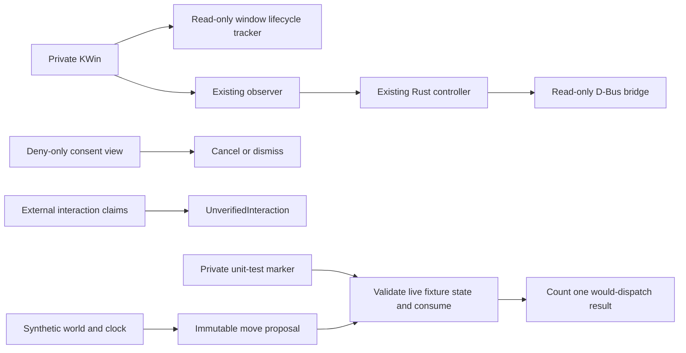

# DepthOS Phase 3 implementation

**PHASE 3 PARTIALLY IMPLEMENTED**

The integration branch starts from `6543b65213f24a733012ac5db50e69ed382d1cfb`. The default build retains the read-only spatial bridge and rejects every interaction claim. The isolated Rust fixture exercises one-use consumption and a counting sink. The consent pane has a cancellation path. KWin's supported scripting surface can observe window and placement changes. A protected approval path and a compositor-owned handoff to the Rust execution turn remain open gates.

## Architecture



The two isolated fixtures exercise different boundaries. Native KWin owns native placement. The Rust unit-test fixture owns the snapshot, lock/seat/prompt facts, clock and sink for a synchronous model turn. There is no runtime edge that converts KWin observations or consent pane events into authorization.

`NativeMoveProposal` captures a generated proposal ID, exact `WindowKey`, native UUID, compositor owner and incarnation, coordinator epoch, observer session and epoch, observation sequence and revision, policy and topology revisions, source, destination, unchanged Activity and monotonic deadline. The model requires synchronized state, a unique UUID and runtime identity, a current window generation, eligible visible placement and exact versions. Placement comes from the fixture snapshot. Caller-supplied titles and application IDs cannot stand in for native identity.

The test authority removes the pending proposal on a matching marker, checks lock, seat and prompt ownership, revalidates placement and continuity, and uses the existing `Authorizer` to consume the capability before invoking the sink. The entire turn holds one exclusive Rust borrow. The sink records a count and may simulate a lost receipt. On lost receipt the model enters an uncertain state and the marker cannot dispatch again. The fixture has no transport or persistence.

## Threat model and security gates

| Input or failure | Enforcement and evidence |
| --- | --- |
| Same-UID session clients, compositor name ownership, asserted click, app name or PID | The production verifier returns `UnverifiedInteraction`. The isolated D-Bus denial fixture exercises six claims across two same-UID connections, including the private compositor name owner. |
| QML callbacks, keyboard input, accessibility requests or synthetic input | The view exports only cancellation. Offscreen tests check that keyboard events and attempted callback lookup cannot approve. Native event provenance for EIS, remote/portal, accessibility and physical input remains unqualified. |
| Reused, stale, expired or ambiguous identities | The model compares window generation, UUID and runtime uniqueness, compositor/observer identity, exact placement, versions and expiration. Replacement, topology change and source drift deny the turn. |
| Lock, seat, focus or prompt ownership change | The model fails closed on missing facts, lock or any captured context change. The QML view dismisses after focus loss. Protected KWin seat, lock and prompt ownership observation is still unqualified. |
| Replay, cancellation, concurrent consumers, lost receipt or worker loss | The fixture serializes exclusive access, spends the matching marker and counts at most once. Observer/compositor loss and teardown remove pending work. Controller lifecycle regressions exercise terminal-state publication and cleanup outcomes. |

The Phase 3.0 verifier remains the sole public proof-acquisition path. `Consent` is opaque and process-local. The fixture proof helper, execution module and sink contract are compiled under `cfg(test)`. Production has no approval endpoint, test-authority runtime switch, native adapter implementation, or assignment mutation in `org.depthos.Controller1`. The local logical CLI retains its existing explicit CRUD operations.

## KWin qualification

The installed packages are KWin `6.8.3-1`, Qt Base `6.12.0-5` and Qt Declarative `6.12.0-4` on Garuda Linux. The version-tagged KWin source shows scripting access to compositor observations and a session D-Bus scripting interface. Quick effect input forwarding gives the view Qt events. A delivered Qt event supplies no attestation that a physical user approved a specific proposal. Protected ingress would require compositor control over event provenance, script integrity, prompt ownership, focus, lock and seat. [Scripting interface](https://github.com/KDE/kwin/blob/v6.8.3/src/scripting/scripting.h) · [Quick effect routing](https://github.com/KDE/kwin/blob/v6.8.3/src/effect/quickeffect.cpp) · [Qt input forwarding](https://github.com/KDE/kwin/blob/v6.8.3/src/effect/offscreenquickview.cpp)

`sha256sum /usr/bin/kwin_wayland` and `readelf -n /usr/bin/kwin_wayland` exited 0. The executable SHA-256 is `33350d420b7b196c1e1f90ffa8c1280b4b3102d4e4b60e1929bad525be93df5e` and its GNU build ID is `6eb58cf1f8d875ef625487ec2f404e8cc969c517`. The tracker uses the script-visible close and workspace removal signals and rechecks workspace membership. Those are the qualified lifecycle surfaces. [Workspace wrapper](https://github.com/KDE/kwin/blob/v6.8.3/src/scripting/workspace_wrapper.h) · [Window properties](https://github.com/KDE/kwin/blob/v6.8.3/src/window.h)

## Workstream status

| Workstream | Implementation | Remaining gate |
| --- | --- | --- |
| 3.1A authority | Immutable synthetic proposal and separate deny-only lifecycle tracker | Trusted handoff of the same live object and coordinator checkpoint |
| 3.1B consent | QML placement view, cancellation, timeout and focus-loss dismissal. Rust fixture checks seat, lock and prompt identity. | Protected compositor prompt ownership and input provenance |
| 3.1C execution | Test-only atomic revalidation, one-use capability and counting sink | Compositor-turn atomicity with a guarded native window |
| 3.2 executor preparation | Private sink contract exercised with the counting implementation. Test compilation is its build gate. | Supported native adapter with combined compositor-owned check, consume and dispatch |
| 3.3 integration | Shared Phase 3.0 authorization model and production D-Bus contract checks | Native authority, prompt and Rust turn remain independently exercised |
| 3.4 verification | See command and performance results below | Physical input, remote/virtual input policy and real mutation remain unqualified |

## Rollback

Keep `main` at the baseline and switch consumers back to that checkout. To remove changes from a branch that has adopted this series, revert its Phase 3 commits in reverse order. Keep unrelated changes, the private historical archive and ignored evidence. The fixture uses disposable resources. Rollback requires no host KWin configuration changes, service changes or package removal.

## Verification

The tests used Garuda Linux `7.3.0-4-garuda` on an Intel Core i5-12450H with 12 logical CPUs, Rust and Cargo 1.100.0, the workspace lockfile and local dependency cache. The QML regressions ran with Qt 6.12.0. Observer and spatial transport tests created private D-Bus sessions.

| Command | Exit | Scope and result |
| --- | ---: | --- |
| `cargo build --workspace --locked --offline` | 0 | Default workspace build |
| `cargo test --workspace --locked --offline` | 0 | 128 passed, including 44 action-security tests and four compile-fail docs. One explicit benchmark was skipped in this run and passed separately. |
| `cargo fmt --all --check` | 0 | Entire Rust workspace |
| `cargo clippy --workspace --all-targets --locked --offline -- -D warnings` | 0 | Entire Rust workspace and test targets |
| `cargo test --workspace --locked --offline --test spatial_bridge --test security_boundary` | 0 | Exact introspection method allowlist, schema capabilities and private-bus denial |
| `cargo test --locked --offline --lib competing_cancel_and_confirmations_obey_authority_turn_order` | 0 | 20 repeats, 16 contended turns per run |
| `cargo test --locked --offline --lib delayed_shutdown_announcement_preserves_terminal_outcome` | 0 | 20 repeats for clean shutdown and cleanup failure |
| `cargo test --locked --offline --test controller_lifecycle cancellation_interrupts_a_stalled_bus_handshake` | 0 | 20 repeats |
| `cargo test --locked --offline --test controller_lifecycle synthetic_1000_window_latency -- --ignored --nocapture` | 0 | 100 synthetic events. Median 13.29 ms, p95 14.04 ms, max 14.80 ms |
| `QT_QPA_PLATFORM=offscreen QT_QUICK_BACKEND=software /usr/lib/qt6/bin/qmltestrunner -input tests/phase-3` | 0 | Eight QtTest results including setup and teardown |
| `nm -C --defined-only target/debug/libdepthos_core.rlib` | 0 | Production symbol table includes the verifier. The fixture symbol search exited 1 with zero matches. |
| `git diff --check 6543b65213f24a733012ac5db50e69ed382d1cfb` | 0 | Integrated patch whitespace |
| `git fsck --full --strict` | 0 | Git object integrity |

Additional private and offscreen regressions all exited 0. Logs are under the ignored `artifacts/phase-3/` directory.

```sh
python3 tests/observer-adapter/private-bus.py
python3 tests/observer-adapter/unified-cli.py
python3 tests/spatial/client-smoke.py
python3 tests/spatial/version-mismatch.py
node --test tests/spatial/model.cjs
env QT_QPA_PLATFORM=offscreen QT_QUICK_BACKEND=software dbus-run-session -- /usr/lib/qt6/bin/qmltestrunner -input tests/spatial/tst_panel.qml
dbus-run-session -- fish scripts/validate-overview.fish
dbus-run-session -- fish scripts/validate-observer.fish
python3 tests/observer-adapter/parity.py
```

## Performance

Five alternating runs compared the baseline commit and the integration build using the established 301-row and 1,000-window fixture. Both builds used locked debug Rust, private D-Bus, the production Plasma QML plugin and offscreen software rendering. Each variant measured 10 paged hierarchy fetches per run and one sample per run for the other metrics. Percentiles use nearest rank. With five samples the p95 equals the maximum.

Each of the ten runs exited 0. The exact command was `env -u DISPLAY -u WAYLAND_DISPLAY python3 tests/spatial/performance.py --output <evidence-json>` from the corresponding source tree. The control build came from a temporary Git archive and used `cargo build --workspace --locked --offline` (exit 0). Files `baseline-1.json` through `baseline-5.json` and `integrated-1.json` through `integrated-5.json` hold the samples.

| Metric | Prior Phase 2.5P median | Fresh baseline median / p95 / max | Integrated median / p95 / max | Samples per variant |
| --- | ---: | ---: | ---: | ---: |
| Initial context to QML (ms) | 410.01 | 417.98 / 449.47 / 449.47 | 416.03 / 430.19 / 430.19 | 5 |
| Native identity removal to QML (ms) | 432.66 | 426.18 / 467.69 / 467.69 | 428.30 / 448.25 / 448.25 | 5 |
| Full paged hierarchy fetch (ms) | 8.86 | 8.94 / 14.81 / 18.83 | 9.02 / 14.01 / 15.77 | 50 |
| Controller RSS (KiB) | 20,952 | 21,028 / 24,124 / 24,124 | 20,884 / 20,948 / 20,948 | 5 |
| Controller idle CPU (% of one core) | ~2.00 | 2.00 / 2.00 / 2.00 | 2.00 / 2.33 / 2.33 | 5 |

The integrated and same-session control medians were close, and both had zero invalidations for the 30-event geometry-only bursts in each trial. The workstation had ordinary foreground load. An earlier sequential control set overlapped agent development and showed materially wider tails, so the table uses the alternating control. These measurements cover the offscreen read-only path. No native compositor latency or FPS measurement was taken.

## Private KWin and host isolation

`python3 tests/phase-3-native/run.py` exited 0 twice on the final code. Each run verified a distinct empty session bus, the private KWin bus owner's exact PID and build, a Wayland socket in a private runtime directory, a virtual output, two private desktops, one private Activity and three owned fixture processes. After isolation checks it loaded the tracker script on the private bus without installing a package. The fixture verified immutable pending preview data, exact live object revalidation, refusal of a different preview object, concurrent proposal refusal, generation increase, and stale-preview refusal after focus loss, owned window removal and removal of the unused private destination desktop. The current fixture desktop was unchanged by the topology exercise.

The same command then ran all eight consent QtTest results on the private Wayland compositor. The tests render fixed placement strings and deliver local test events to their own view. This verifies native Wayland presentation and dismissal. There is no authority-to-QML proposal handoff in this test. The launch uses a private compositor with the lock screen disabled, so it establishes no native lock, seat or trusted-input policy.

The host comparator uses read-only D-Bus for the host compositor owner, desktops, effects and Activity. It compares the monitored configuration bytes and autostart and extension paths on disk. It never connects to the host Wayland socket, so host window inventory and focus are outside the comparison. Final runs recorded equality for all monitored fields, removal of the private process group, Wayland socket and temporary XDG roots. Earlier runs returned exit 1 on changed host current desktop, including an integrated run in which the native tracker and eight QML tests had passed. The comparator did not restore host state. The raw integrated outputs are under `artifacts/phase-3/native-*.log`.

## Release decision

The deny-only defaults are verified. Positive dispatch and the lock, seat, epoch and acknowledgement fault cases are model evidence. The native tracker rechecks live window state synchronously but does not bind the coordinator checkpoint, implement monotonic expiration or consume a Rust capability. A real adapter remains disabled pending a supported compositor-owned handoff that proves all three together. Native provenance for EIS, remote/portal, accessibility and physical actions is unresolved. These gaps block the full Phase 3 verdict and any authorization for native mutations.
