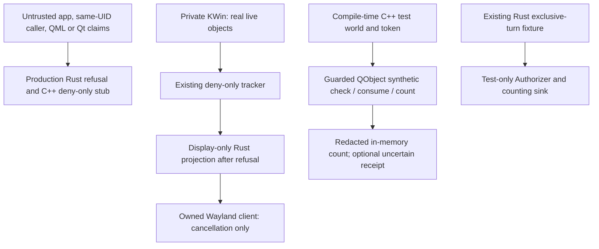

# Phase 3.6 native authority prototype

This campaign adds a separated C++ deny-only stub and a compile-time-only synthetic authority kernel. It does not add a KWin plugin, protected prompt, native proof issuer, native setter or Rust/native authorization transport. The existing real private KWin tracker remains the live-native observation experiment. The [feasibility report](phase-3-native-authority-feasibility.md) explains why a positive protected boundary requires compositor changes.

## Agent 1 implementation inventory

- `experiments/kwin-authority/native/authority.h`: `DenyOnlyAuthority` always refuses every origin claim. Under `DEPTHOS_AUTHORITY_UNIT_TEST` only, `synthetic::Kernel` binds an immutable proposal to guarded QObject window/prompt identities, generation, UUID, source/destination/Activity, topology, seat, lock, compositor/observer/coordinator epochs and a five-second `std::chrono::steady_clock` deadline. Matching consumption removes the pending proposal before validation and permanently retires that instance. Cancellation and teardown also retire it. Counted and uncertain outcomes cannot be retried or prepared again on that instance. There is no persisted assignment or window placement write.
- `tests/phase-3-native/authority-kernel.cpp`: deterministic attacks against the sampled synthetic world, QObject deletion/recreation, duplicate identity, expiry, clock reversal, context drift, cancellation, one-use and lost acknowledgment; wrong-thread entry is refused. Positive behavior increments one redacted in-memory integer.
- `tests/phase-3-native/authority-kernel.py`: compiles independent deny-only and synthetic executables using installed Qt6Core and warnings-as-errors, checks the deny-only symbol table lacks the synthetic namespace, runs both without inherited bus/display variables, then deletes temporary binaries. It has no KWin loader call, package installation or runtime enabling flag.
- The feasibility report and this report. Reviewer changes and the exact integrated commit inventory are recorded separately in [security review](phase-3-native-security-review.md).

Cargo dependencies, production Rust code, D-Bus interfaces, existing QML and accepted tracker are unchanged by Agent 1. The existing Rust tests remain the more complete synthetic `Authorizer` proof/capability model. The C++ kernel adds actual Qt guarded-object destruction and steady-clock mechanics, not a second production authorization design.

## Trust boundaries



There is deliberately no edge from the Wayland view, native tracker or public claims into either positive test kernel. A private D-Bus session protects host isolation; it does not authenticate human consent within that session. The C++ test world owns its input assertions and cannot establish actual KWin lock/seat/prompt integrity.

## Exact synthetic guarantee

Under the fixture contract that all world mutation and guarded QObject destruction occur serially on the creating thread, the matching confirmation copies its immutable proposal, clears pending state, retires the instance, checks current guarded identity and sampled state, then increments a local counter synchronously. It invokes no callback, Qt signal, nested event loop, native setter or IPC. Wrong-thread confirmation returns before reading world/pending state. This provides a single-use synthetic check/consume/count sequence for one proposal per kernel lifetime, including terminal uncertain completion. Creating a different test instance is not recovery or exactly-once persistence.

`QPointer<QObject>` clearing proves only Qt object's destruction behavior. It is not a retained `KWin::Window`, does not test KWin's deleted-for-animation lifecycle and is not mapped to a native UUID. The kernel uses a test-owned snapshot and numeric epochs. It cannot independently check a live Rust coordinator checkpoint. Transient focus/lock/topology events that return to identical state need immediate invalidation by an authority-owned observer; the kernel has `cancel()`/`teardown()`, but no native event subscriptions. The existing KWin script observes some real lifecycle transitions separately. Neither path supplies the missing protected boundary.

## Initial verification and limitations

Run from the isolated checkout:

```sh
python3 tests/phase-3-native/authority-kernel.py
```

Agent 1's initial command exited 0 using C++20 and Qt 6.12.0. Both binaries deny all seven external origin labels. The deny-only binary contains no synthetic namespace symbols. Twenty-five attack mutations refuse and count zero: focus loss; locked/unknown lock; wrong/unknown seat; replaced/absent/unowned prompt; changed source/Activity/eligibility; removed destination; topology, observer, coordinator, compositor or generation drift; changed/duplicate UUID; duplicate object; destruction/recreation; compositor or authority teardown; cancellation. Additional checks cover foreign serial, pending conflict, one-use counting, cancel after consumption, lost acknowledgment without retry/reprepare, clock reversal, exact inclusive expiry and foreign-thread refusal. These are synthetic cases. They do not verify native injection filtering, a genuine protected approval or concurrent QObject mutation safety.

The reviewer independently runs the unchanged genuine private KWin/Wayland fixture and all Rust, QML, D-Bus, adversarial, host isolation and comparable offscreen performance checks. Final commands, results and corrections supersede this initial checkpoint where explicitly stated in the review and validation reports.

## Rollback

The campaign stays on `codex/phase-3-6`; neither main nor the accepted Phase 3 branch is changed. Use the accepted worktree to return to `f73226097aced5f414dc1d1a901debb3eab510fc`. To remove this campaign from a branch that adopted it, revert its commits in reverse order, preserving unrelated work. Remove ignored evidence separately only when no validation uses it. Temporary C++ binaries and private compositor resources are disposable. No host KWin binary, extension, package, autostart entry or configuration needs restoration because none is installed or modified by the experiment.
