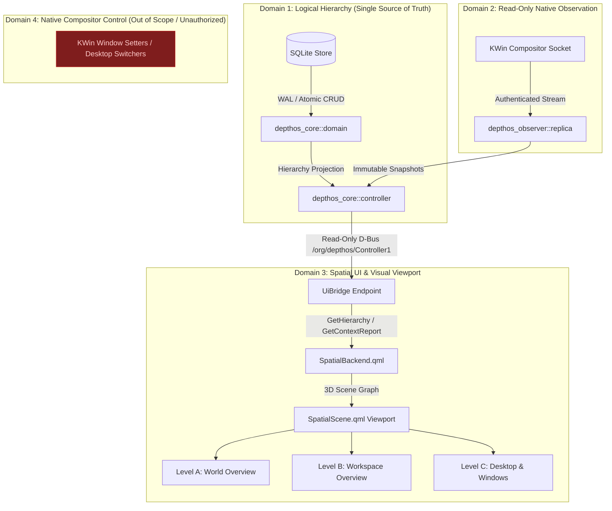

# DepthOS Phase 4.1: Spatial Workspace Alpha Architecture

## 1. Executive Summary & Alpha Mandate

DepthOS Phase 4.1 delivers the complete, runnable implementation of the **Spatial Workspace Alpha**. The spatial workspace introduces an interactive, GPU-accelerated spatial canvas operating over native Wayland compositors (starting with KDE Plasma 6 / KWin 6), organizing tasks across three navigable depth levels: **Worlds**, **Workspaces**, and **Logical Desktops**.

A core architectural tenet of Phase 4.1 is the **strict enforcement of security and operational boundaries**:
- The native desktop integration is **strictly read-only**.
- DepthOS provides zero native KWin window placement setters, performs no native desktop switching, moves no native windows across virtual desktops, and exposes no writable production endpoints to untrusted clients.
- The single source of truth for all logical workspaces remains SQLite, accessed exclusively via typed domains in `depthos_core`.

---

## 2. Architectural Boundaries & Domain Separation

DepthOS Phase 4.1 maintains four cleanly segregated architectural domains:

### Domain Distinction Matrix

| Domain | Responsibility | Persistence / State | Authority & Permissions |
| :--- | :--- | :--- | :--- |
| **1. Logical Hierarchy** | Defines Worlds, Workspaces, and Logical Desktops. | Persistent SQLite database (`~/.local/share/depthos/workspaces.sqlite3`). | Authoritative. Mutation via typed CLI or Rust API only. |
| **2. Native Observation** | Observes native windows, active desktop, and screens. | Ephemeral in-memory replica (`depthos_observer`). | Strictly read-only. No mutation capabilities. |
| **3. Spatial Navigation** | Visual camera movement, Z-depth scaling, and local search. | Ephemeral UI client state (QML/QtQuick). | Visual-only. Does not switch native KDE desktops. |
| **4. Native Window Placement** | Moving real windows or changing active native desktop. | Native compositor state (KWin). | **Prohibited / Out of Scope** in Phase 4.1 Alpha. |

---

## 3. Single Source of Truth: SQLite & Controller

All logical groupings (Worlds, Workspaces, Desktops) are maintained exclusively in SQLite via `depthos_core::domain`. The spatial UI maintains zero independent or diverging copies of the hierarchy.

1. **Hierarchy Invariants**:
   - Every Desktop belongs to exactly one Workspace.
   - Every Workspace belongs to exactly one World.
   - Deleting a parent requires leaves to be deleted first, or explicit cascading under domain rules.
2. **Controller Projection**:
   - `depthos_core::controller::Controller` reads the hierarchy and joins it with the current immutable snapshot from `depthos_observer`.
   - The UI bridge (`UiBridge` in `src/spatial/mod.rs`) serves paged, bounded JSON payloads over the session bus at `org.depthos.Controller`.
3. **Failure Isolation**:
   - If the observer drops or KWin restarts, the logical hierarchy remains completely accessible. The UI transitions to an `Unavailable` or `Reconnecting` observation state badge, preserving all logical workspaces and navigation.

---

## 4. Read-Only Native Integration & Security Boundary

The spatial workspace Alpha operates under strict isolation rules established in Phase 3.10.1:

1. **No Placement Setters**:
   - The UI layer does not have access to, nor does it invoke, any KWin scripting API setters (such as `client.desktop = ...`, `workspace.activeWindow = ...`, or `workspace.currentDesktop = ...`).
2. **No Production Consent Issuer**:
   - In Alpha, no automatic consent or background window migration is permitted.
3. **Read-Only D-Bus Interface (`org.depthos.Controller1`)**:
   - `GetCapabilities()`: Explicitly advertises `readOnly: true`, `assignmentMutations: false`, `selectionOwner: "client"`.
   - `GetControllerHealth()`: Returns current controller lifecycle, observation health, and database availability.
   - `GetHierarchy(cursor, revision)`: Paginated logical rows (`world`, `workspace`, `desktop`).
   - `GetContextReport(cursor, revision)`: Paginated window association decisions with status and target desktops.
   - `invalidated(instance, scopes)`: Signal emitted on data updates (scope 1 = hierarchy, scope 2 = context).

---

## 5. Viewport Lifecycle & Standalone Execution Architecture

The Spatial Workspace Alpha can be launched in two operational modes:

1. **Integrated Controller Mode**:
   - Connected to the running DepthOS Controller daemon via D-Bus session bus.
   - Real-time hierarchy updates and live observer synchronization.
2. **Standalone Demo / Mock Mode**:
   - Automatically engaged when the DepthOS Controller is offline, or when invoked with `--mock` / `--demo`.
   - Populates rich multi-world, multi-workspace topologies and provides window observation cards illustrating all badge states (`Live`, `Stale`, `Reconnecting`, `Unavailable`, `Unknown`).
   - Zero background daemons or compositor plugins required for development, testing, and UX design review.
