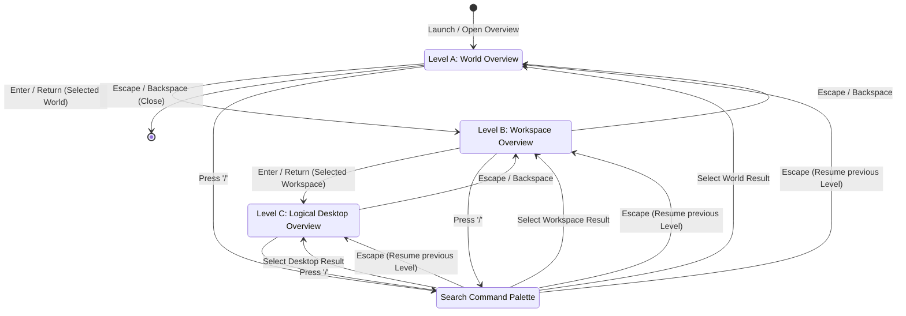

# DepthOS Phase 4.1: Keyboard Navigation & Search System

## 1. Keyboard-First Philosophy

DepthOS is built for power users, engineers, and researchers who operate keyboard-first. Every spatial interaction—from macroscopic world hopping to window card selection—is completely accessible via standard home-row navigation keys without requiring a mouse or pointer device.

---

## 2. Core Navigation Bindings

| Key | Binding | Target Depth Level | Action / Behavior |
| :--- | :--- | :--- | :--- |
| **`H`** / **`Left`** | Previous Sibling | Levels A, B, C | Move focus to previous item horizontally. |
| **`L`** / **`Right`** | Next Sibling | Levels A, B, C | Move focus to next item horizontally. |
| **`J`** / **`Down`** | Move Down | Levels A, B, C | Move focus down one row (or to next desktop in Level C). |
| **`K`** / **`Up`** | Move Up | Levels A, B, C | Move focus up one row (or to previous desktop in Level C). |
| **`Enter`** / **`Return`** | Enter Deeper | All Levels | Advance depth level: World → Workspace → Desktop → Window Focus. |
| **`Escape`** / **`Backspace`** | Return to Parent | All Levels | Step back depth level: Search → Desktop → Workspace → World → Close. |
| **`/`** (Slash) | Open Command Search | All Levels | Opens modal search palette across Worlds, Workspaces, Desktops. |
| **`Home`** | Center / Home | All Levels | Resets camera coordinates (`cameraX = 0, cameraY = 0`) to active item. |
| **`[`** / **`]`** | Previous / Next Desktop | Level C | Directly switches between linked logical desktops in active workspace. |
| **`T`** | Toggle Titles | All Levels | Toggles window title privacy redaction on/off. |
| **`M`** | Toggle Motion | All Levels | Toggles reduced-motion mode (instantaneous transitions). |

---

## 3. Hierarchy Traversal State Machine

### Deterministic Focus Rules
1. **Selection Preservation**:
   - Selecting a World preserves the previously selected Workspace and Desktop within that World.
   - If no previous selection exists, the first child in lexical/order sequence is automatically selected.
2. **Boundary Clamping**:
   - Pressing `H` on the first sibling clamps to index `0` (does not wrap unpredictably unless cycling is explicitly commanded).
   - Pressing `L` on the last sibling clamps to the final index.
3. **Deterministic Focus Ring**:
   - Every active item renders a high-contrast cyan/indigo focus border (`border.color: isFocused ? "#38BDF8" : ...`). Focus never becomes invisible or ambiguous.

---

## 4. Search & Direct Context Navigation

Pressing `/` opens the lightweight client-side **Search Command Palette (`SearchPalette.qml`)**:

### Search Capabilities
- Real-time substring and token matching across:
  1. **Worlds**: Matches World name and description.
  2. **Workspaces**: Matches Workspace name, parent World name, description, and root directory.
  3. **Desktops**: Matches Desktop name, role, and parent Workspace name.
- Results are tagged with colored category badges: `[WORLD]`, `[WORKSPACE]`, `[DESKTOP]`.

### Direct Camera Navigation Algorithm
When the user selects a search result and presses `Enter`:
1. The target context coordinates (`worldId`, `workspaceId`, `desktopId`) are updated in `SpatialBackend`.
2. The visual camera navigates directly to the target depth level:
   - Target is a **World**: `currentLevel = 1` (Level A).
   - Target is a **Workspace**: `currentLevel = 2` (Level B).
   - Target is a **Desktop**: `currentLevel = 3` (Level C).
3. The search palette closes smoothly and active focus is returned to the scene graph.
