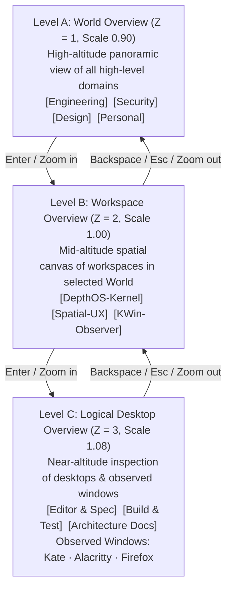

# DepthOS Phase 4.1: Spatial UX & Visual Design System

## 1. Overview & Spatial Philosophy

DepthOS Phase 4.1 replaces flat window taskbars and fragmented virtual desktop pagers with a unified **3D Spatial Workspace**. Tasks and applications are organized along an intuitive Z-axis depth scale, allowing users to move fluidly between high-level project domains (Worlds), focused task canvases (Workspaces), and atomic window workspaces (Logical Desktops).

---

## 2. The Three Navigable Depth Levels



### Level A: World Overview
- **Visual Presentation**: High-altitude panoramic spatial canvas rendering all Worlds in a balanced grid.
- **Card Contents (`WorldCard.qml`)**:
  - High-contrast identity glyph and domain color accent (e.g. 💻 `#6366F1`, 🛡️ `#EC4899`, 🎨 `#06B6D4`, ☕ `#10B981`).
  - World Title & subtitle: "Level A: World Overview".
  - Workspace count pill: e.g. "3 Workspaces".
  - Context summary description detailing the world's operational domain.
  - Preview tags/chips of the first four workspaces inside this world.
  - Deterministic animated focus indicator and selection elevation.
- **Interaction**:
  - `H` / `L` (or Arrow Left/Right): Move selection horizontally between sibling Worlds.
  - `J` / `K` (or Arrow Down/Up): Move selection vertically across World grid rows.
  - `Enter` / `Return` / `Space`: Move deeper into the selected World (transitions to Level B).

### Level B: Workspace Overview
- **Visual Presentation**: Mid-altitude view focusing on the workspaces belonging to the active World. The parent world identity is visible in the top context header.
- **Card Contents (`WorkspaceCard.qml`)**:
  - Workspace title & git branch / root directory indicator.
  - Description of the workspace task context.
  - Linked logical desktops (count and names).
  - Observed window count pill (e.g. "4 windows observed").
  - Miniature desktop preview tiles showing window distribution.
  - Observation status freshness badge (`Live`, `Stale`, `Reconnecting`, `Unavailable`, `Unknown`).
- **Interaction**:
  - `H` / `L`: Move horizontally between sibling Workspaces in the active World.
  - `J` / `K`: Move vertically across workspace rows.
  - `Enter`: Move deeper into the selected Workspace (transitions to Level C).
  - `Backspace` / `Escape`: Return to Level A (World Overview).

### Level C: Logical Desktop Overview & Observed Windows
- **Visual Presentation**: Near-altitude detailed inspection view showing the linked logical desktops and observed native windows.
- **Surface Contents**:
  - **Desktop Selector Tabs**: Horizontal selector allowing rapid switching between linked logical desktops (e.g. `[Editor & Spec] [Build & Test] [Architecture Docs]`).
  - **Window Cards (`WindowCard.qml`)**:
    - Application identity glyph and display name (e.g. Kate, Alacritty, Firefox).
    - Safe application identity (`desktopFileName` or sanitized resource class).
    - Window title with privacy redaction support (toggled via `T`).
    - Observation status freshness badge (`Live`, `Stale`, `Reconnecting`, `Unavailable`, `Unknown`).
    - State badges: `Active Focus`, `Minimized`, `Fullscreen`.
    - Window preview thumbnail or metadata fallback canvas.
  - **Empty / Unavailable States**:
    - Clean empty state banner when no windows are mapped to the desktop.
    - Unavailable state indicator when compositor observation is offline.
- **Interaction**:
  - `H` / `L`: Cycle between window cards on the current desktop.
  - `[` / `]`: Switch between linked logical desktops.
  - `Enter`: Focus / inspect selected window.
  - `Backspace` / `Escape`: Return to Level B (Workspace Overview).

---

## 3. Spatial Rendering & Motion Design

### Scene Graph Acceleration
All rendering is performed using Qt Quick's hardware-accelerated scene graph. Transforms are computed using GPU vertex shaders rather than CPU canvas redraws:
- Viewport scaling uses `Scale { origin.x: ...; origin.y: ...; xScale: currentScale; yScale: currentScale }`.
- Spatial panning uses `Translate { x: cameraX; y: cameraY }`.

### Parallax & Depth Cues
- **Background Cosmic Grid**: The coordinate grid plane shifts at a 15% parallax ratio relative to camera translation (`x: cameraX * 0.15, y: cameraY * 0.15`), imparting subtle spatial depth.
- **Depth Scaling**:
  - Level A (World Overview): Scale = `0.90` (camera pulled back).
  - Level B (Workspace Overview): Scale = `1.00` (baseline).
  - Level C (Logical Desktop Overview): Scale = `1.08` (camera pushed forward).
- **Layer Transitions**: Smooth cross-fades and easing curves (`Easing.OutCubic`) provide continuity during level changes.

### Interruption-Safe Animation Architecture
Animations use declarative `Behavior` properties anchored to current instantaneous values:
```qml
Behavior on cameraX {
    NumberAnimation { duration: scene.motionOff ? 0 : 280; easing.type: Easing.OutCubic }
}
Behavior on currentScale {
    NumberAnimation { duration: scene.motionOff ? 0 : 320; easing.type: Easing.OutCubic }
}
```
When a user rapidly taps navigation keys (e.g., tapping `L` repeatedly), the animation re-targets dynamically from its current position without jumping or lagging.

---

## 4. Accessibility & Reduced-Motion Mode

DepthOS strictly adheres to accessibility guidelines:
- **Reduced-Motion Toggle**: Pressing `M` (or passing `--reduced-motion` on CLI) sets `reducedMotion: true`.
- **Zero Animation Durations**: When `motionOff` is active, all animation durations are set to `0` ms, resulting in instantaneous, non-animated state transitions.
- **High-Contrast Focus Rings**: All interactive surfaces feature high-contrast focus borders (`#38BDF8` with distinct glow outline) ensuring full keyboard navigation clarity for accessibility tools.
