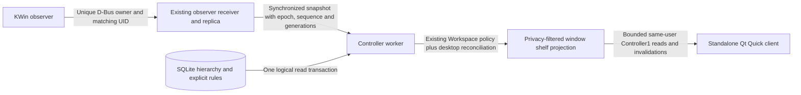

# Phase 4.3 architecture

The baseline is `64f53e74b81d7de229dc15412c108a07a67f347e`, descended from Phase 4.2 `43609632c5ecb09dedc2270cdb98d4a0f0f1a2f7` and canonical main `6543b65213f24a733012ac5db50e69ed382d1cfb`. Both checkouts were clean and full Git integrity passed before branching.

The receiver validates publisher ownership and UID on each call, binds the consumer using Hello, and reduces frames in epoch and sequence order. Missing frames invalidate continuity until a trusted snapshot replaces the replica. A runtime ID identifies a window only with the replica epoch and generation. Native window UUIDs can collide or be reused. The existing Workspace context maintains in-memory claims keyed by its own context epoch, runtime ID, and generation. It filters application and dialog observations using known-false capture protection and taskbar exclusion flags. Its read API has no assignment mutation. The UI obtains hierarchy and health through the unique controller owner and separately supports local read-only SQLite and demo sources.

Phase 4.3 joins current observations with explicit logical rules in the same controller worker. SQLite stores durable rules only. The shelf endpoint exposes opaque observation-scoped IDs and an allowlist of display fields. The existing Workspace context and native execution interfaces remain separate from this projection.
