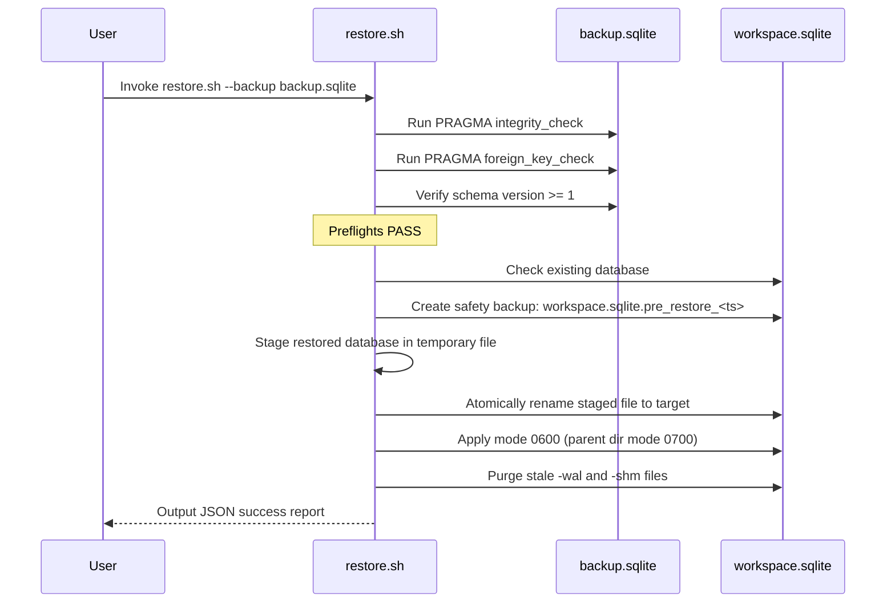

# DepthOS Phase 4.6 Database Backup and Restore Specification

## 1. Overview and Invariants

DepthOS uses an embedded SQLite database (`workspace.sqlite`) operating under Write-Ahead Logging (`WAL`) mode to store workspace hierarchies, logical desktops, association rules, and client preferences. Phase 4.6 introduces dedicated tools (`backup.sh` and `restore.sh`) designed to guarantee transactional consistency, verify database integrity, and enforce strict filesystem permission boundaries.

### Safety Invariants
1. **Online Non-Blocking Consistency**: The backup procedure utilizes the native SQLite Online Backup API (`sqlite3_backup`) rather than raw file copies, ensuring that uncheckpointed WAL frames and concurrent read operations never produce a corrupt or partial snapshot.
2. **Pre-Restoration Integrity Gate**: A backup file is thoroughly checked (`PRAGMA integrity_check`, `PRAGMA foreign_key_check`, schema version verification) before any modification is made to the target database.
3. **Pre-Restore Safety Snapshot**: If the target database already exists, an automatic timestamped backup is preserved before replacement.
4. **Strict Permission Confinement**: All restored database files are constrained to mode `0600`, and parent directories are constrained to mode `0700`.

---

## 2. Backup Tool (`backup.sh`)

### Execution Syntax
```bash
./backup.sh --output <BACKUP_PATH> [--db <DB_PATH>] [--dry-run]
```

### Key Capabilities
- **Default Database Discovery**: Automatically locates `$XDG_DATA_HOME/depthos/workspace.sqlite` if `--db` is omitted.
- **Transactional Consistency**: Connects in read-only URI mode (`file:...mode=ro`) and performs an online page-by-page backup to the target destination.
- **Cryptographic Accounting**: Computes the SHA-256 hash of the generated backup and formats a structured JSON report.
- **Permissions**: Enforces `0600` on the backup file.

### Example Backup Invocation
```bash
./backup.sh --output ~/depthos-backups/workspace-20261121.sqlite
```
JSON Response:
```json
{
  "status": "SUCCESS",
  "timestamp": "2026-11-21T15:20:00Z",
  "source_db": "/home/user/.local/share/depthos/workspace.sqlite",
  "backup_path": "/home/user/depthos-backups/workspace-20261121.sqlite",
  "schema_version": 3,
  "integrity": "ok",
  "foreign_keys": "ok",
  "mode": "0600",
  "sha256": "3e9b...a10f",
  "size_bytes": 163840
}
```

---

## 3. Restore Tool (`restore.sh`)

### Execution Syntax
```bash
./restore.sh --backup <BACKUP_PATH> [--target <DB_PATH>] [--dry-run] [--force]
```

### Restoration Workflow



### Safety Features
- **Staging and Atomic Rename**: The restored database is written to a temporary sibling file (`workspace.sqlite.tmp_<PID>`), permissions are set to `0600`, and its integrity is verified before an atomic `rename()` replaces the active database.
- **Companion File Pruning**: Any lingering `-wal` or `-shm` files belonging to the previous instance are safely removed to prevent stale journal playback against the freshly restored database.
