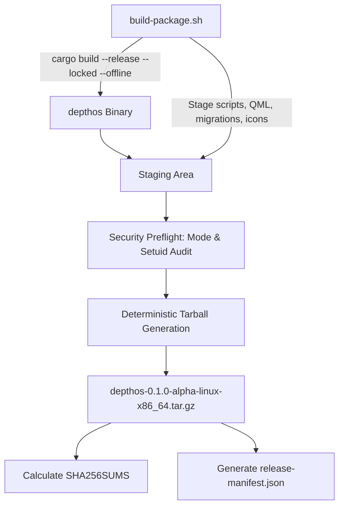

# DepthOS Phase 4.6 Package Architecture Specification

## 1. Overview and Design Principles

DepthOS Phase 4.6 establishes a reproducible, secure, and self-contained distribution packaging architecture for the DepthOS Private Alpha. The release artifact is built as an offline-deterministic compressed tarball (`depthos-0.1.0-alpha-linux-x86_64.tar.gz`) coupled with cryptographic checksums (`SHA256SUMS`) and a structured metadata inventory (`release-manifest.json`).

### Architectural Tenets
1. **Zero Source Tree Dependency**: Installed binaries and companion QML modules discover runtime dependencies via prefix-relative paths, XDG standard specifications, or explicit environment overrides, eliminating any dependence on the development repository.
2. **Strict Security Boundaries**:
   - Production native authorization mechanisms remain **DENY-ONLY**.
   - Production native observation interfaces remain strictly **READ-ONLY**.
   - Zero setuid or setgid bits are permitted across all packaged binaries and scripts.
   - Installation into world-writable or traversing symlinked destinations is proactively rejected.
3. **Manifest-Guided Lifecycle**: Every installation produces a cryptographic manifest (`.depthos-manifest.json`) recording absolute and relative file paths, SHA-256 digests, and octal permissions. Upgrade, rollback, and uninstallation operations are guided exclusively by this manifest.
4. **User Data Inviolability**: User databases (`$XDG_DATA_HOME/depthos/workspace.sqlite`), preferences, logs, and custom artwork are strictly isolated from application binaries and are never modified or purged during package removal or downgrade.

---

## 2. Distribution Package Contents

The distribution tarball unpacks into a single root directory (`depthos-0.1.0-alpha-linux-x86_64/`) containing:

```
depthos-0.1.0-alpha-linux-x86_64/
├── bin/
│   ├── depthos                   # Core compiled Rust binary (mode 0755)
│   └── depthos-spatial-alpha     # QtQuick/QML Python launcher & host bridge (mode 0755)
├── share/
│   └── depthos/
│       ├── spatial-alpha/        # QML scene graph, shaders, components, and art
│       └── migrations/           # SQL schema migrations (001, 002, 003)
├── pkg/
│   ├── depthos.desktop           # FreeDesktop application entry (mode 0644)
│   ├── depthos.svg               # Scalable 512x512 vector icon (mode 0644)
│   ├── install.sh                # Preflight-hardened installer
│   ├── uninstall.sh              # Manifest-guided uninstaller
│   ├── upgrade.sh                # Staged atomic package upgrader
│   ├── rollback.sh               # Previous installation snapshot restorer
│   ├── backup.sh                 # Online consistent SQLite backup tool
│   └── restore.sh                # Preflight-validated SQLite restorer
├── install.sh                    # Symlink / direct wrapper to pkg/install.sh
├── uninstall.sh                  # Symlink / direct wrapper to pkg/uninstall.sh
├── upgrade.sh                    # Symlink / direct wrapper to pkg/upgrade.sh
├── rollback.sh                   # Symlink / direct wrapper to pkg/rollback.sh
├── backup.sh                     # Symlink / direct wrapper to pkg/backup.sh
├── restore.sh                    # Symlink / direct wrapper to pkg/restore.sh
├── LICENSE                       # Private Alpha Evaluation Agreement
└── NOTICES.md                    # Third-party licensing audit and attribution
```

---

## 3. Destination Prefix Filesystem Layout

When installed into a target prefix (default: `$HOME/.local`), the filesystem structure is organized as follows:

| Filesystem Path | Mode | Purpose |
|---|---|---|
| `<prefix>/bin/depthos` | `0755` | Core CLI daemon and SQLite manager binary |
| `<prefix>/bin/depthos-spatial-alpha` | `0755` | Spatial launcher and QtQuick viewport host |
| `<prefix>/share/depthos/spatial-alpha/` | `0755` (dirs) / `0644` (files) | QML modules, JavaScript utilities, procedural artwork |
| `<prefix>/share/depthos/migrations/` | `0755` (dirs) / `0644` (files) | SQL schema version migrations |
| `<prefix>/share/depthos/.depthos-manifest.json` | `0644` | Cryptographic inventory of all installed files |
| `<prefix>/share/depthos/.rollback/` | `0700` | Automated snapshot of previous installation before upgrade |
| `<prefix>/share/applications/depthos.desktop` | `0644` | FreeDesktop application launcher entry |
| `<prefix>/share/icons/hicolor/scalable/apps/depthos.svg` | `0644` | High-DPI application icon |

User state is intentionally segregated into `$XDG_DATA_HOME/depthos/` (mode `0700`), where `workspace.sqlite` is kept under strict mode `0600`.

---

## 4. Manifest Schema (`.depthos-manifest.json`)

```json
{
  "schema_version": "1.0",
  "package_name": "depthos",
  "package_version": "0.1.0-alpha",
  "installed_at": "2026-11-21T15:00:00Z",
  "prefix": "/home/user/.local",
  "security_mode": "DENY-ONLY",
  "observation_mode": "READ-ONLY",
  "file_count": 83,
  "files": [
    {
      "path": "bin/depthos",
      "absolute_path": "/home/user/.local/bin/depthos",
      "sha256": "4a1f...9b2c",
      "mode": "0755",
      "size_bytes": 12894560
    }
  ]
}
```

---

## 5. Security & Verification Pipeline



All distribution packaging operations are verified against offline build constraints and fail closed on any security violation.
