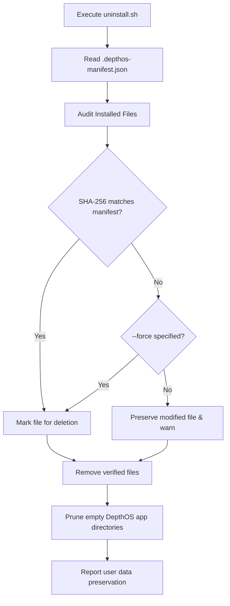

# DepthOS Phase 4.6 Uninstallation Guide

## 1. Overview and Invariants

The DepthOS uninstallation tool (`uninstall.sh` / `pkg/uninstall.sh`) cleanly removes installed DepthOS program files without risking user data loss or corrupting shared system directories.

### Core Invariants
1. **Manifest-Driven**: Removal is governed strictly by the cryptographic manifest generated at installation time (`<prefix>/share/depthos/.depthos-manifest.json`). No unrecorded files are touched.
2. **User Data Inviolability**: Workspaces, layout databases (`workspace.sqlite`), preferences, user-supplied custom artwork, and audit logs stored in `$XDG_DATA_HOME/depthos/` (or `~/.local/share/depthos/`) are **strictly preserved**.
3. **User Modification Defense**: If an installed file was modified after installation (SHA-256 digest mismatch), the uninstaller preserves the file by default and alerts the operator.
4. **Shared Directory Containment**: Common shared directories (`<prefix>/bin`, `<prefix>/share`, `<prefix>/share/applications`, `<prefix>/share/icons`) are never removed. Only dedicated empty DepthOS subdirectories are cleaned up.

---

## 2. Command-Line Options

```bash
./uninstall.sh [OPTIONS]

Options:
  --prefix <DIR>    Installation prefix (default: $HOME/.local)
  --dry-run         Simulate file removal without deleting any files
  --force           Remove installed files even if modified after installation
  -h, --help        Show usage help
```

---

## 3. Uninstallation Workflow



---

## 4. Examples

### Standard Dry-Run Simulation
```bash
./uninstall.sh --prefix ~/.local --dry-run
```
Output:
```
Discovered 83 files in manifest:
  - Verified for removal: 83
  - Modified by user (preserved): 0
  - Already absent: 0

Dry run simulation complete. Zero files were removed.
```

### Clean Removal with Modified File Protection
```bash
./uninstall.sh --prefix ~/.local
```
If a file such as a migration was edited locally:
```
WARNING: The following files have been modified since installation and will NOT be deleted:
  - /home/user/.local/share/depthos/migrations/001_initial.sql (use --force to remove)

Removing verified files...
Installation manifest retained because modified files were preserved.
SUCCESS: DepthOS uninstallation completed.
USER DATA PRESERVED: User workspaces, database records, and logs in
  $XDG_DATA_HOME/depthos/ remain untouched.
```
