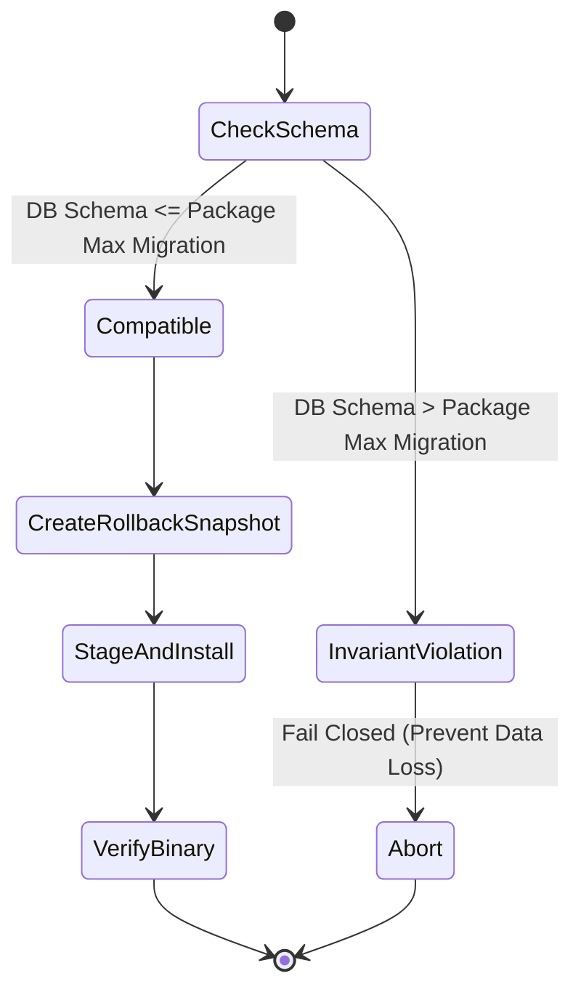

# DepthOS Phase 4.6 Upgrade and Rollback Specification

## 1. Upgrade Architecture (`upgrade.sh`)

The DepthOS package upgrade utility provides atomic, staged upgrades from a distribution archive (`.tar.gz`) into an existing installation prefix.

### Execution Syntax
```bash
./upgrade.sh --package <TARBALL> [--prefix <DIR>] [--dry-run]
```

### Operational Workflow
1. **Archive Integrity Verification**:
   The upgrade script validates the tarball's internal structure, verifying that essential runtime components (`bin/depthos`, `bin/depthos-spatial-alpha`, `install.sh`, migrations) are present.
2. **Database Forward-Only Invariant Enforcement**:
   The script inspects the maximum migration version contained within the archive (e.g. `migrations/003_*.sql`). If an active user database exists (`$XDG_DATA_HOME/depthos/workspace.sqlite`), it queries `PRAGMA user_version`. If the user database has migrated to a version higher than what the target package supports, the upgrade is **aborted immediately** to prevent schema incompatibility.
3. **Rollback Snapshot Creation**:
   The active `.depthos-manifest.json` and all installed files are copied into `<prefix>/share/depthos/.rollback/` (mode `0700`).
4. **Staged Extraction & Installation**:
   The archive is extracted into a temporary directory `<prefix>/share/depthos/.staging_upgrade_<PID>/` and the packaged `install.sh` executes with the target prefix.
5. **Post-Upgrade Smoke Verification**:
   The upgraded `depthos --version` is invoked to confirm operational viability before finishing.

---

## 2. Database Forward-Only Invariant

DepthOS enforces a strict database safety principle:

> **Invariant**: SQLite database schemas only move forward. Automated software updates must never downgrade the database schema or execute backwards SQL alterations.



If a user database is at schema version `3` and an older package supporting only version `2` is provided to `upgrade.sh`, the process fails closed with:
```
DATABASE SAFETY ERROR: Forward-only schema invariant violation.
User database is at schema version 3, but package only supports version 2.
Downgrading database schema is strictly prohibited.
```

---

## 3. Rollback Procedure (`rollback.sh`)

If an upgraded version fails operational testing, the previous installation can be restored from the automated snapshot.

### Execution Syntax
```bash
./rollback.sh [--prefix <DIR>] [--dry-run]
```

### Rollback Process & Safety Checks
1. **Snapshot Presence & Verification**:
   Validates `<prefix>/share/depthos/.rollback/.depthos-manifest.json` exists and that all stored files match their expected SHA-256 digests.
2. **Schema Invariant Check**:
   Verifies whether the database has been migrated past the rollback version's capabilities. If the database schema was already upgraded, rolling back the binary could cause failure to read new tables/columns. The tool alerts the operator and blocks the rollback unless the database schema matches.
3. **File Restoration**:
   Restores all binaries, assets, desktop files, and the previous manifest with strict permissions (`0755` for executables, `0644` for data).
4. **Confirmation**:
   Runs `<prefix>/bin/depthos --version` to confirm restored CLI operational health.
