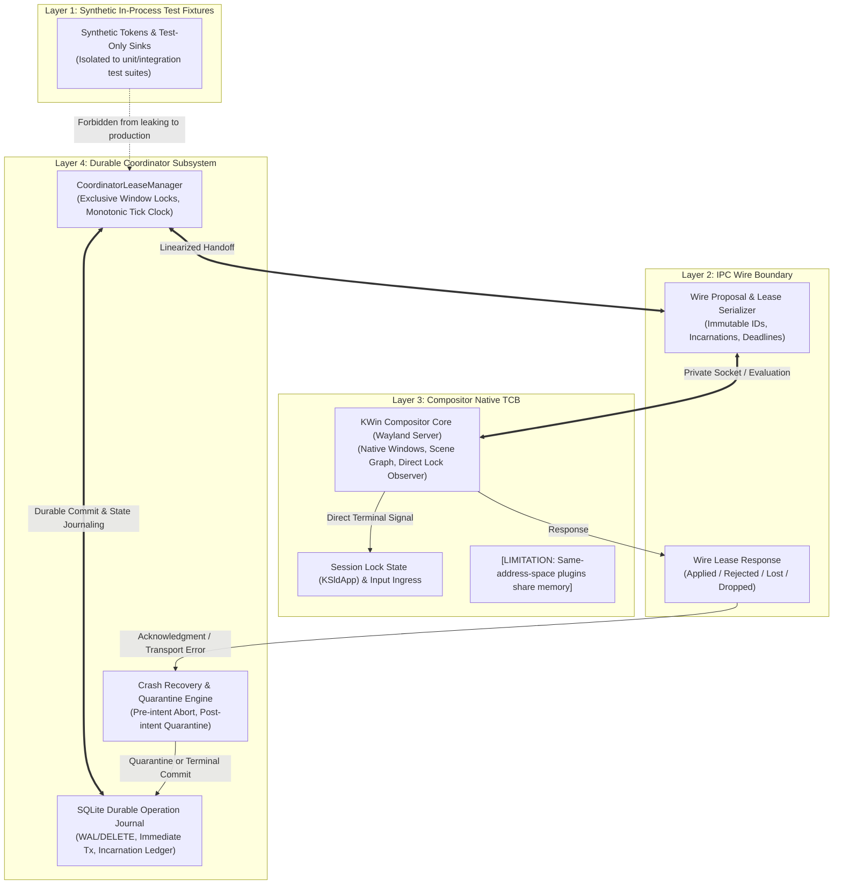

# Phase 3.9 Adversarial Threat Model and Security Architecture

**Author**: DepthOS Independent Security Reviewer & Correction Engineer (Agent 2)  
**Target Repository**: `/home/ashenix/Projects/DepthOS-phase-3-9`  
**Target Branch**: `codex/phase-3-9`  
**Classification Date**: November 2026  
**Scope**: Durable Coordinator Protocol, SQLite Journaling, Crash Recovery, and Security Contract Verification

---

## 1. Executive Summary & Purpose

Phase 3.9 advances DepthOS action security from an in-memory coordinator reservation prototype into a **durable, crash-resilient coordinator protocol backed by a transactional SQLite operation journal**. 

This document defines the formal adversarial threat model, attacker profiles, trust boundaries, failure classification taxonomies, attack vector catalogs, and independent verification criteria. It serves as the authoritative blueprint for evaluating:
1. **Durable Operation Journal & State Machine**: State transitions (`Created` -> `Reserved` -> `Prepared` -> `DispatchIntentRecorded` -> `SyntheticDispatchAttempted` -> `Acknowledged` -> `Completed` / `Quarantined` / `Aborted` / `Reconciled`), terminal absorption, and durable replay protection.
2. **Crash & Power-Loss Recovery**: Fault injection at all linearization boundaries (pre-intent vs. post-intent crashes, crash during synthetic dispatch, crash during ack recording, crash during quarantine).
3. **SQLite Durability, Concurrency, and Contention**: Journal modes (WAL vs. DELETE), synchronous flush pragmas (`FULL` vs. `NORMAL`), transaction isolation (`TransactionBehavior::Immediate`), busy timeout resilience, corruption detection, and crash consistency.
4. **Coordinator Protocol & Incarnation Fencing**: Distributed coordination across coordinator restarts, compositor restarts, observer sequence gaps, and clock reversals.
5. **Security Contract Verification & Claim Discipline**: Strict audit of architectural claims to prevent overstatement of cryptographic protection, hardware seat attribution, in-process extension isolation, distributed atomicity, and power-loss guarantees.

---

## 2. Trust Boundaries & Architectural Horizons

DepthOS action security spans four strictly separated architectural horizons:

### Trust Boundary Rules
1. **Durable Journal vs. Memory State**: Memory state in `CoordinatorLeaseManager` is ephemeral and must be strictly reconstructible from, or fenced by, the SQLite journal upon restart. In any conflict between uncommitted memory state and durable database state, durable database state takes precedence.
2. **Dispatch Intent as the Point of No Return**: A mutation dispatch to Layer 3 cannot occur until the intent is durably committed to Layer 4 storage (`DispatchIntentRecorded`).
3. **Uncertainty Invariant Across Reboots**: If a crash occurs after `DispatchIntentRecorded` but before confirmed receipt of outcome, the recovery engine **MUST** assume dispatch may have occurred, and **MUST** restore the window into a `Quarantined` state. It must never assume non-execution, and must never retry.
4. **Compositor Native TCB vs. Coordinator**: The Coordinator cannot force native window relocation without compositor consent. If the compositor crashes or restarts, its incarnation UUID changes, immediately fencing all active leases.
5. **Production Boundary Immutability**: Production D-Bus interfaces export strictly read-only inspection methods. No writable RPC methods exist to initiate leases, alter journals, or execute window actions.

---

## 3. Failure & Crash Taxonomies

To prevent ambiguity, failures are rigorously classified into five distinct physical and logical domains:

| Failure Class | Physical / Logical Mechanism | Impact on State & Storage | Recovery Expectation | Supported in Testbed? |
|---|---|---|---|:---:|
| **Class A: Simulated Process Interruption** | Explicit cancellation, drop of receiver, test fixture stop. | Process terminates cleanly. Uncommitted buffers flushed by OS. Database consistent. | Clean rollback or safe startup. | **YES** |
| **Class B: Immediate Process Termination** | `SIGKILL`, `panic=abort`, sudden process exit (`std::process::exit(1)`). | In-flight memory lost. OS closes file descriptors. SQLite rollback journal or WAL recovery handles rollback of incomplete transactions. | Operations prior to commit are rolled back. Committed intent triggers quarantine. | **YES** |
| **Class C: Storage Lock & Contention** | Multiple threads/processes acquire concurrent write locks (`SQLITE_BUSY`). | Transactions fail or wait up to `busy_timeout`. No corruption. | Handled gracefully via immediate transactions and fail-closed errors. | **YES** |
| **Class D: Storage Data Corruption** | Bit flips, partial sector writes, truncated file header, corrupted WAL frame. | Database integrity check fails (`PRAGMA integrity_check`). Queries return `SqliteFailure(Corrupt)`. | Fail closed immediately. Refuse to dispatch. Quarantine active windows. | **YES (Simulated)** |
| **Class E: Operating System Crash & Power Loss** | Sudden kernel panic, hardware power cut, SSD controller power loss. | OS page cache lost. Unflushed dirty pages lost. Relies on disk hardware obeying `fsync`. | SQLite WAL/FULL synchronous ensures consistency *if* hardware sync works. | **FORMALLY UNSUPPORTED** (Virtual testbed lacks power-cut hardware) |

> [!IMPORTANT]
> **Power-Loss Safety Qualification**: Because virtualized container environments cannot verify physical SSD battery-backed write caches or non-volatile memory controller flush semantics under actual power loss, **Class E Power-Loss Safety is formally classified as UNSUPPORTED** in the DepthOS testbed. The system guarantees Class A, B, C, and D recovery.

---

## 4. Adversarial Attack Vector Catalog

### Category 1: State Machine Edge Cases & Lifecycle Attacks

- **Attack 1.1: Dispatch Without Prior Durable Intent**
  - *Threat*: The coordinator attempts to dispatch a synthetic or native proposal before committing `DispatchIntentRecorded` to SQLite.
  - *Mitigation & Invariant*: State machine enforces that `consume_synthetic` requires prior verification that the journal row is in `DispatchIntentRecorded` state within a committed transaction.
- **Attack 1.2: Illegal Resurrection of Terminal Leases**
  - *Threat*: An operation in `Completed`, `Aborted`, `Expired`, or `Reconciled` is resubmitted or transitioned back to `Active` or `Prepared`.
  - *Mitigation & Invariant*: Terminal states are strictly absorbing. Transitioning out of a terminal state produces `LeaseError::AlreadyTerminal` or `Error::InvalidState`.
- **Attack 1.3: Premature Lease Release Before Outcome Resolution**
  - *Threat*: Window lock is released while dispatch is in-flight, allowing a concurrent proposal to alter window placement before the first operation completes.
  - *Mitigation & Invariant*: Window lock is held throughout `Reserved`, `Prepared`, `DispatchIntentRecorded`, and `SyntheticDispatchAttempted`. It is released ONLY upon confirmed terminal resolution or converted into a quarantine lock upon uncertainty.
- **Attack 1.4: Duplicate Operation ID Injection Across Reboots**
  - *Threat*: An attacker captures an old `operation_id` that completed in a previous coordinator session and replays it after coordinator restart.
  - *Mitigation & Invariant*: `operation_id` is a primary key in the durable journal with permanent tombstoning. Replaying any previously seen `operation_id` returns `LeaseError::Replay`.
- **Attack 1.5: Incomplete Rollback on Transaction Failure**
  - *Threat*: Database error occurs midway through recording intent; in-memory lease manager retains `Active` state while database rolled back.
  - *Mitigation & Invariant*: Transaction boundaries synchronize memory and storage. Failure of the database transaction aborts the in-memory lease and unlocks the window.

### Category 2: Coordinator Protocol & Fencing Attacks

- **Attack 2.1: Duplicate Window Reservation Race**
  - *Threat*: Concurrent threads attempt to acquire leases for the same target window simultaneously.
  - *Mitigation & Invariant*: Coordinator lease manager and SQLite unique constraints ensure only one winner. Exactly one thread succeeds; all competing threads receive `LeaseError::Conflict`.
- **Attack 2.2: Stale Coordinator Incarnation / Epoch Acceptance**
  - *Threat*: A delayed message or lease bearing an old coordinator epoch is presented for dispatch.
  - *Mitigation & Invariant*: Incarnation fencing verifies `coordinator_incarnation` and `coordinator_epoch` match the current live coordinator. Mismatched epochs fail with `LeaseError::CoordinatorMismatch`.
- **Attack 2.3: Stale Compositor Incarnation Acceptance**
  - *Threat*: Compositor restarts (new UUID). A lease acquired under the old compositor tries to dispatch.
  - *Mitigation & Invariant*: Compositor incarnation mismatch triggers immediate revocation and failure with `LeaseError::CompositorMismatch`.
- **Attack 2.4: Monotonic Clock Reversal & Overflow**
  - *Threat*: System clock jumps backwards, or an operation submits a TTL of `u64::MAX`.
  - *Mitigation & Invariant*: Monotonic `Tick` enforces non-decreasing timestamps (`LeaseError::ClockReversed`). Arithmetic overflow is checked with `checked_add` and returns `LeaseError::CounterExhausted`.
- **Attack 2.5: Quarantine Bypass Without Authoritative Evidence**
  - *Threat*: A quarantined window is targeted by a new lease request before authoritative state reconciliation occurs, or reconciliation is requested with arbitrary/unverified tokens.
  - *Mitigation & Invariant*: Quarantined windows reject all acquisitions (`LeaseError::Quarantined`). Reconciliation requires verified authoritative evidence of current window state.

### Category 3: Crash Recovery & Fault-Cut Attacks

- **Attack 3.1: Crash Cut at Point 1 (Before Intent Recorded)**
  - *Cut Point*: Crash occurs while lease is in `Created` or `Reserved`.
  - *Recovery Requirement*: On coordinator restart, recovery engine inspects journal. Because dispatch intent was not durably recorded, the operation is marked `Aborted`. The window is NOT quarantined and is available for subsequent operations.
- **Attack 3.2: Crash Cut at Point 2 (After Intent Recorded, Before Dispatch Attempt)**
  - *Cut Point*: Intent is committed to SQLite, but process is killed immediately before the network/sink call is made.
  - *Recovery Requirement*: Recovery engine cannot know if the dispatch reached the sink or was delayed in OS buffers. The operation MUST be transitioned to `Quarantined`, locking the window against all subsequent mutations until reconciliation.
- **Attack 3.3: Crash Cut at Point 3 (During / Immediately After Dispatch)**
  - *Cut Point*: Dispatch executed by sink, but process killed before receiving or writing acknowledgment.
  - *Recovery Requirement*: Operation recovered as `Quarantined`. Window locked. Retry strictly forbidden.
- **Attack 3.4: Crash Cut at Point 4 (After Acknowledgment Recorded)**
  - *Cut Point*: Acknowledgment recorded as `Completed` in SQLite, then process killed.
  - *Recovery Requirement*: On restart, operation remains `Completed`. Window is unlocked. Replay is rejected.
- **Attack 3.5: Crash During Crash Recovery**
  - *Cut Point*: Process crashes while recovering the journal during startup.
  - *Recovery Requirement*: Startup recovery must be idempotent. Re-running recovery on subsequent launch yields the identical consistent state without duplicate entries or corruptions.

### Category 4: SQLite Storage Contention & Corruption Attacks

- **Attack 4.1: SQLite Database Lock Contention (`SQLITE_BUSY`)**
  - *Threat*: Multiple workers or background threads bombard the journal with simultaneous transactions, causing lock timeouts.
  - *Mitigation & Invariant*: Journal uses `TransactionBehavior::Immediate` and a configured `busy_timeout`. Contention is resolved cleanly or fails closed with descriptive storage errors, never corrupting the ledger.
- **Attack 4.2: Malformed or Corrupted Journal Rows**
  - *Threat*: Manual or out-of-band tampering inserts corrupted JSON, invalid UUIDs, or illegal state strings into `durable_journal`.
  - *Mitigation & Invariant*: Parser validates row integrity upon query. Corrupted rows trigger immediate journal quarantine and fail-closed rejection.
- **Attack 4.3: Filesystem Link or Permission Tampering**
  - *Threat*: Symlink substitution or permission relaxation (`0666`) on the database file.
  - *Mitigation & Invariant*: Inherited from `SqliteStore`: strict `O_NOFOLLOW`, mode `0600`, single hard link verification, and owner-only parent directory enforcement.

### Category 5: Security Contract Claim Verification

The review must scrutinize all Phase 3.9 documentation (`docs/phase-3-9-*`) to ensure zero overstatement of capabilities:
1. **No Cryptographic Overstatement**: UUIDs, ticks, and tokens are software identifiers, not hardware-backed cryptographic signatures or HMACs.
2. **No Claim of True In-Process Extension Isolation**: In monolithic KWin, in-process C++ plugins share address space. Isolation claims must be scoped to external Wayland clients and unprivileged D-Bus peers.
3. **No Claim of Physical Seat Attestation**: libinput/sysfs device classification is diagnostic heuristic telemetry, not tamper-proof hardware attestation.
4. **No Claim of Distributed 2PC Atomicity**: DepthOS does not implement a two-phase commit across asynchronous D-Bus. Atomicity is achieved by local coordinator reservations and fail-closed quarantine.
5. **No Claim of Exactly-Once Delivery**: The system provides at-most-once execution by quarantining upon lost acknowledgments and preventing replay.
6. **No Claim of Bare-Metal Power-Loss Safety**: Power-loss safety is formally unsupported in the virtual test environment.

---

## 5. Independent Verification Matrix & Plan

| Attack Vector | Target Subsystem | Verification Method | Pass Criteria |
|---|---|---|---|
| 1.1 - 1.5 | State Machine Transitions | Rust Unit & Integration Tests | Terminal absorbing states; durable intent required; replay rejected; no window lock leaks. |
| 2.1 - 2.5 | Coordinator Protocol & Fencing | Multi-threaded Concurrency Harness | 100% single winner on window races; stale epoch/incarnation rejected; quarantine bypass blocked. |
| 3.1 - 3.5 | Crash-Cut Matrix (5 Cut Points) | Dedicated Crash Recovery Suite | Pre-intent aborts safely; post-intent quarantines; recovery is 100% idempotent. |
| 4.1 - 4.3 | Storage Contention & Corruption | SQLite Concurrency & Fault Injector | Immediate tx prevents deadlocks; busy timeout honored; corrupted rows fail closed. |
| 5.1 - 5.6 | Contract Documentation Audit | Manual Line-by-Line Claim Review | Zero unsupported claims; power loss marked unsupported; boundaries explicitly qualified. |

---

## 6. Execution Authority

This threat model governs the independent security review and validation for Phase 3.9. All findings, defect reproductions, corrections, and final verdicts will be documented in `docs/phase-3-9-security-review.md` and `docs/phase-3-9-validation.md`.
